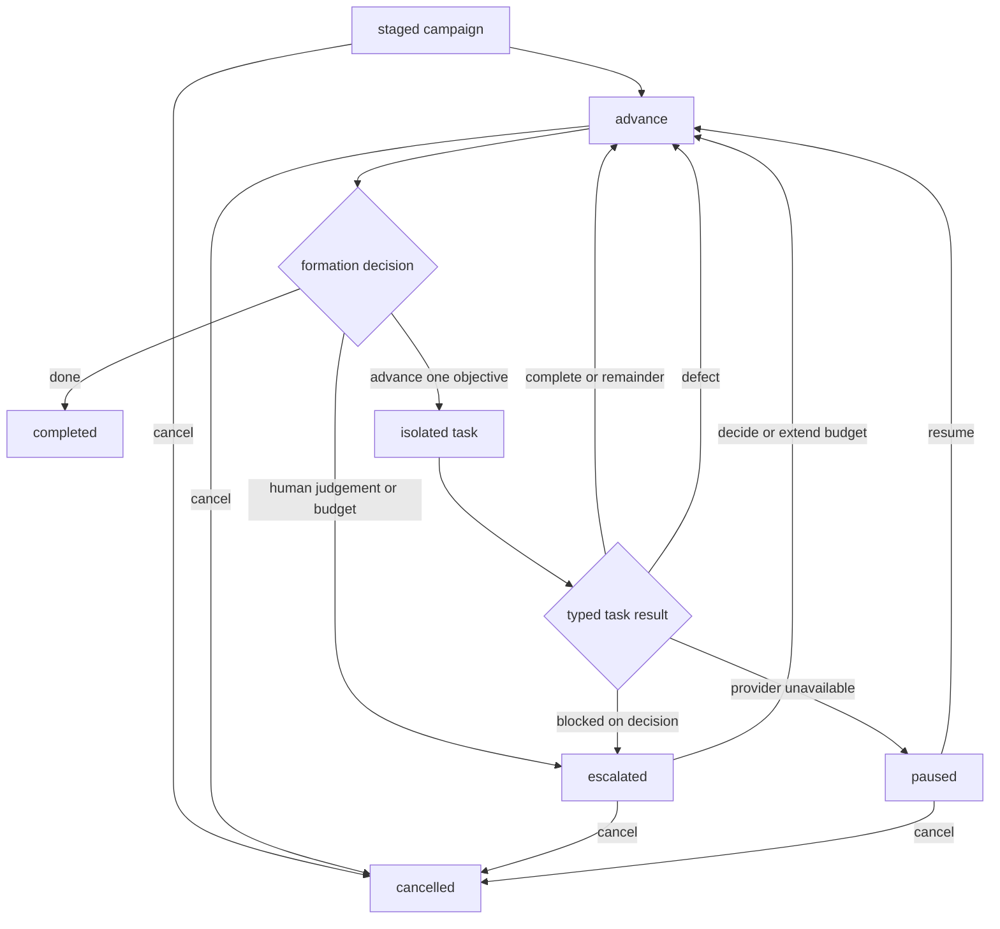

# Tasks and Campaigns

For a worked example, read [Make a tool safe to adopt](../stories/campaign.md).
For preserved work, read [Finish a change that stopped](../stories/recover-work.md).

Foundry has two engineering dispatch primitives:

- A **task** executes one concrete objective immediately.
- A **campaign** holds a broader mission and derives one task at a time from
  current repository state until evidence proves the mission complete.

Campaigns do not contain a pre-cut queue. The next objective is created only
when the preceding task has a typed result, so stale downstream inventory and
per-item retry loops are unnecessary.

For a shared outcome across campaigns, use an [initiative](initiatives.md).
The initiative supplies the brief, shared findings, owner decisions and stage
providers. Each member campaign still derives its own next objective.
Once `initiative advance` enables steering, a settled member reports its result
before the initiative chooses the next action. Passive initiatives retain the
usual independent campaign loop.

## Why campaigns reassess scope

Implementation is a source of new knowledge. It can expose hidden dependencies,
invalid assumptions, partial solutions, and work that is already complete.
Campaign formation reassesses the full remaining mission after each implementation
cycle. It uses actual implementation experience, reviewer findings, preserved work,
and current repository evidence to derive the next objective.

The reassessment can change scope, priority, or task decomposition within the
mission and owner constraints. It can retain an earlier objective when the evidence
still supports it. It does not merely select the next item from an initial plan
or repeat the reviewer's gap list.

The final reassessment checks the whole mission. A complete task verdict proves
its assigned objective, which can be narrower than campaign completion.

Evaluate formation by whether it uses new evidence to choose appropriate work and
preserves useful learning. Assessment token volume and the ratio of formation to
implementation sessions do not establish waste. When reducing cost, preserve the
full reassessment and the evidence it needs. The charter records this as a design principle.

## Choosing a Task or Campaign

Use a task when you can state one objective whose acceptance evidence is
available now:

```bash
foundry task parite-cli \
  "Add a --quiet flag and prove it suppresses progress output"
```

Use a campaign when any of these are true:

- the mission spans several independently reviewable changes;
- later work depends on what the repository reveals after earlier work lands;
- the work may require an explicit owner decision;
- production or other external evidence is part of completion;
- a bounded cycle budget is needed to limit autonomous work.

A campaign is deliberately not a substitute for a backlog. If the work is
already a known sequence of unrelated tasks, dispatch those tasks directly.
Campaign formation is valuable when each next objective should be derived from
mission minus current evidence.

## Lifecycle at a Glance



`cancelled` is terminal and has no edge back: it records that the mission was
abandoned, not achieved. Use `paused` for a campaign meant to resume.

Each dispatched task consumes one cycle. Formation, retries caused by a
transient decision-provider transport failure, and an automatic provider pause
do not consume cycles. A landed final task still receives completion evaluation. An exhausted budget
with an unlanded non-complete result escalates before gates or formation run.

## Durable Ownership

The daemon owns the durable campaign inventory. Online
`foundry campaign add/list/show/advance/pause/resume/decide/complete/cancel` all
go through typed gRPC and do not read, create, or mutate `FOUNDRY_CAMPAIGNS_PATH`.
Successful online reads and mutations render the daemon's typed response
directly, so stale client-side campaign files cannot mask the live daemon-owned
state. Pass `--offline` only for direct-file recovery while the daemon is
stopped. If the daemon is unreachable, the online command fails and leaves any
absent or pre-existing client-side `FOUNDRY_CAMPAIGNS_PATH` byte-identical.

The read-only inventory surface starts with two gRPC queries:

- **`ListCampaigns`** — returns summary/status records sorted by campaign name,
  with an optional exact `project` filter. Missing or empty stores return an
  empty list; malformed or unreadable stores return a gRPC error rather than an
  implicit empty inventory.
- **`GetCampaign`** — retrieves the complete definition of one campaign by exact
  name, including `intent_refs`, `context_paths`, all `done_evidence` entries
  with the `Gate`/`Review` type distinction preserved, and escalation rules.
  Returns `NOT_FOUND` (not an implicit empty) when the name is absent from the
  store.

## One-Shot Tasks

```bash
foundry task parite-cli "Add a --quiet flag and prove it suppresses progress output"
foundry task parite-cli "Fix the parser regression" --agent codex
```

The task formation:

1. Creates a disposable Git worktree under `~/.foundry/worktrees/`.
2. Runs the coding agent and quality gates inside that worktree.
3. Performs a read-only skeptical review against the objective and evidence.
4. Emits one typed verdict: `complete`, `remainder`, `defect`,
   `blocked_on_decision`, or `runner_error`.
5. Commits all task work before returning a terminal result.

When the provider refuses the agent session as unavailable (a model at
capacity, an overloaded or rate-limited API, or HTTP 429, 503 or 529), the
executor waits and tries again: after 30 seconds, 2 minutes and 5 minutes. If
the fourth attempt is also refused, the task ends as `runner_error` with a
detail that starts `provider unavailable` and `failure_kind:
provider_unavailable` on `task_run_completed`. No gate runs and no review
session runs, so a run that never started is never reported as a defect or as
missing proof. Terminal account failures (spend limit, disabled account,
revoked authentication) also skip the review and end as `runner_error`.

The provider's wording counts even when the agent CLI's output was not
classified. An unclassified failure, or an agent that could not start, whose
message names a model at capacity, an overload or a rate limit is treated as
`provider_unavailable` in the same way.

Any other execution session that fails before it does work (an error the
provider reports that no rule recognises, an agent that cannot start, a stream
that times out) also ends as `runner_error`, without a review session or a
proof check. The detail is the session's own message, for example `plan
execution failed: <message>` or `agent unavailable: <error>`. "Before it does
work" means the session changed no project file (changes under `.foundry/` and
auxiliary worktree paths do not count) and left no `.foundry/proof.json` or
`.foundry/blocker.json`. A failed session that did change files, or that wrote
early evidence, is reviewed as usual: the proof check runs, then the reviewer.
A session that finished but wrote no proof is still a `defect`.

Two verdicts may fast-forward the registered trunk branch. A `complete` verdict
with passing required gates lands, as does a `remainder` — the reviewer's term
for a finite list of missing work on a _converging_ implementation — provided at
least one required gate ran and every required gate passed. Converging work
integrates rather than accumulating a long-lived divergent branch, and the green
required gates are what keep trunk from going red; a `remainder` with no
required gate to vouch for it does not land. Its reviewer gaps travel forward in
the typed result and become the campaign's next objective.

### When trunk moves during a task

A task can run for an hour. On a shared repository, other people and sessions
push to trunk in that time. The task branch then cannot fast-forward trunk,
but that says nothing about the quality of the work. Foundry reconciles it:

1. It fetches trunk and rebases the task branch onto it inside the task
   worktree.
2. If the rebase is clean, it runs the project's required gates again on the
   rebased tree (fix commands do not run).
3. If the gates pass, the rebased work lands.
4. If trunk moved again while the gates ran, Foundry does steps 1–3 one more
   time. It makes no more than two rebase attempts in one task.

If the rebase conflicts, a required gate fails on the rebased tree, or trunk
is still moving after the second attempt, Foundry puts the branch back on the
reviewed commit and preserves it as usual. The reviewer's verdict does not
change. A `complete` that could not land is still `complete`, with `landed:
false`, `success: false`, and a typed `land_blocked` reason in the
`task_run_completed` payload:

| `land_blocked`             | Meaning                                                                               |
| -------------------------- | ------------------------------------------------------------------------------------- |
| `trunk_moved_conflict`     | Trunk moved during the run and the rebase conflicted                                  |
| `trunk_moved_gates_failed` | Trunk moved during the run; the rebase was clean, but a required gate failed after it |
| `stale_base_conflict`      | The run started from a base already behind trunk and the rebase conflicted            |
| `stale_base_gates_failed`  | The run started behind trunk; the rebase was clean, but a required gate failed        |
| `trunk_moved_repeatedly`   | Trunk moved again after the second rebase                                             |
| `checkout_not_ready`       | The registered checkout was dirty or on the wrong branch                              |
| `git_failed`               | Another git operation needed to land failed                                           |

A `git_failed` summary quotes only the last 4 KiB of git's error output, after
a note that gives the number of omitted bytes. Git writes the output of
repository hooks to the same stream, and a pre-push hook can write a full
validation run. The error from git itself is at the end.

Foundry tells "moved during the run" from "started behind" by the start the
executor records when it prepares the task worktree (`workspace_base`: the
worktree's first commit and the trunk commit it observed). A run that recorded
no start, because it began before Foundry recorded one, keeps the
`trunk_moved_*` reason, and its summary says that the cause is unknown.

The payload also lists in `trunk_arrivals` the trunk commits that the task
branch did not contain (commit and subject, oldest first). This list is
present when the work landed after a rebase too. When trunk did not move, the
payload has neither field and the result is the same as before.

### When a continuation starts behind trunk

A campaign cycle that follows an unlanded cycle, a `foundry queue resume`, and
a nightly majors continuation start from preserved work: a branch, a commit,
or a `bundle:<path>`. Trunk can move between the cycle that preserved the work
and the cycle that continues it. Before the agent session starts, Foundry
brings the continuation onto current trunk:

1. It fetches the registered trunk (`origin/<branch>`). If origin cannot be
   reached, it uses the local branch, which is where finalize lands.
2. If the preserved commit already contains trunk, the worktree starts on the
   preserved commit, as before.
3. If not, it rebases the preserved commits onto trunk in the new task
   worktree. The worker then starts from trunk plus the preserved work. The
   preservation ref is not rewritten; only the new task branch moves.
4. If that rebase conflicts, Foundry starts one reconciliation session on
   current trunk.

The session uses the same admitted task and repository slot. It does not reserve
other projects or add a campaign cycle. The original preserved ref stays unchanged.
The `reconciliation` field records the source ref, resolved commit, observed trunk,
and conflicting paths through execution, review and completion events.

The agent compares the preserved changes with trunk and reapplies the remaining
intended behavior. It must explain adaptations and omissions. It cannot rewrite
the source history. Acceptance proof, required gates, review and normal landing
checks still apply. A later trunk change uses the normal landing checks.

If reconciliation does not land, the campaign enters recovery instead of starting
another automatic cycle. A product choice keeps its explicit owner question.
Operational blockers keep their typed recovery. An explicit recovery recheck can
permit further work; it does not silently refund or add cycles. Standalone tasks
retain the normal explicit resume control. Legacy refused-continuation events
remain readable.

A `complete` with a `land_blocked` reason is preserved work to reconcile, not
a defect. Its work item settles `preserved` and its reason names the block.
The next campaign cycle starts from the preserved branch (brought onto
current trunk first, see below), and the campaign history shows the cycle as
`complete, did not land (<reason>)`. The nightly
majors lane does not dispatch the same upgrade again while that branch
exists.

`defect`, `blocked_on_decision`, and `runner_error` never land. Every result
that does not land is pushed to a named preservation branch; if no remote push
is possible, Foundry writes a Git bundle under `~/.foundry/preserved/`. Either
way the next cycle resumes from the preserved work; a bundle also carries
`HEAD`, so you can fetch or clone it by hand to recover the work yourself. Tasks
do not retry. A campaign decides whether the preserved result should seed
another objective.

### When preserved work was settled outside the campaign

The next cycle continues from the last cycle's preserved ref only while that
work is still owed. Before formation, Foundry reads the work-item ledger and
finds the campaign's cycle item whose disposition records that ref (the latest
one submitted, if there are several). If that item is settled `cancelled` or
`landed`, the ref no longer carries forward:

- `cancelled`: an owner ran `foundry queue close` on it, for example after
  cherry-picking the work onto trunk by hand.
- `landed`: supersession detection found the work on trunk and settled the
  item with the reason `superseded by <commit>`.

The next cycle then starts from the registered trunk. Formation's `ACCUMULATED
UNMERGED WORK` section names the ref, the work item, its state and its reason,
and tells formation not to treat that work as pending. An item that is still
`preserved`, `needs_decision` or `failed` keeps carrying its work forward, as
does a ref that no item records. If the ledger cannot be read, the cycle
continues from the ref, as before, and the daemon logs a warning.

Without this check, a manual advance after an owner reconciled the work by
hand replays the old ref. The continuation guard then refuses the cycle
because the old commits conflict with trunk, and the owner's cycle is spent
with no agent session. To use this, close the item before you advance.

## Campaign Definitions

Create a JSON definition file:

```json
{
  "name": "parite-phase-2d",
  "project": "parite-cli",
  "mission": "Prove both retrieval entrypoints preserve raw response identity.",
  "intent_refs": ["parite.intent.raw-retrieval-evidence"],
  "context_paths": [".alloy/projections/AGENTS.generated.md"],
  "done_evidence": [
    {
      "kind": "gate",
      "command": "cargo test -p parite-core retrieval_parity",
      "required": true,
      "artifacts": ["crates/parite-core/tests/retrieval_parity.rs"]
    },
    {
      "kind": "review",
      "statement": "The parity suite compares unmasked response IDs across both real entrypoints."
    }
  ],
  "budget": { "max_cycles": 12 },
  "escalation": ["A behavior choice requires an owner decision."],
  "authorized_by": "Stacey",
  "agent_provider": "codex"
}
```

### Definition fields

| Field               | Required      | Meaning                                                       |
| ------------------- | ------------- | ------------------------------------------------------------- |
| `name`              | Yes           | Stable campaign identifier, unique in the campaign store      |
| `project`           | Yes           | Exact registered project name                                 |
| `mission`           | Yes           | Durable outcome the formation evaluates                       |
| `intent_refs`       | No            | Opaque identifiers connecting the mission to source intent    |
| `context_paths`     | No            | Existing repository-relative neutral artifacts                |
| `done_evidence`     | Yes           | At least one mechanical gate or review statement              |
| `budget.max_cycles` | No            | Maximum dispatched tasks; defaults to 20                      |
| `escalation`        | No            | Conditions that require the formation to stop for an owner    |
| `authorized_by`     | Operationally | Owner identity required for decisions, completion, and resume |
| `agent_provider`    | No            | Campaign-specific provider override                           |

`context_paths` must be existing repository-relative files under the registered
checkout. Absolute paths, parent traversal, missing files, and symlink escapes
are rejected before the definition is saved. Foundry reads these neutral
artifacts but never invokes the tool that produced them.

Formation uses the balanced model tier with medium reasoning effort. The
independent task reviewer continues to use the deep tier with high effort.
Context files are listed by path and size for selective reading. Their normative
requirements still apply. Formation receives the mission, owner decisions,
reviewer gaps, recent commits, changed paths, and compact gate results.
It returns a decision; the daemon dispatches that decision. It must not probe
localhost or start nested Foundry workflows.

Passing gate output is omitted. Failed output keeps at most 512 bytes per gate
and 2 KiB across all gates. The shortening keeps the end of every section of
the output (stdout, stderr, and each self-heal run), so noisy stderr cannot
hide the stdout line that names the failure. Full results remain in
`CampaignAdvanceCompleted`, and a failed gate's `logs` field names the files
that hold its complete output (see
[Gate output and full logs](iteration-workflow.md#gate-output-and-full-logs)).
An oversized packet fails before an agent starts. Binding declarations are
never silently truncated to fit the packet.

### Stage limits and repository scope

Campaign definitions accept these limits. Older definitions use these defaults:

```json
{
  "writable_repositories": ["my-project"],
  "budget": {
    "max_cycles": 4,
    "stages": {
      "formation_prompt_bytes": 32768
    }
  }
}
```

The prompt byte limit must be positive. Campaign formation, execution, and
review have no clock deadline, including the project's agent timeout. Legacy
stage time fields are ignored when reading existing definitions. The byte limit
applies to the rendered Foundry prompt, not provider instructions or files read
during a turn.

An empty `writable_repositories` means the campaign's project alone. Admission
rejects any other declaration. Multi-repository isolation and landing are not
supported. Sibling repositories remain read-only.

Campaign execution currently needs Codex to enforce this filesystem boundary.
An omitted campaign provider selects Codex. Other campaign providers fail before
formation starts. Codex uses `workspace-write`, clears inherited extra writable
roots, and permits Foundry's command-log directory. Foundry owns Git finalization.
Standalone tasks retain their existing provider and access behavior.

### Capture command output

Use the following command for verbose builds and tests:

```bash
foundry capture -- cargo test --workspace
```

This command needs no daemon. It returns the child's exit code and stores both
complete streams in `~/.foundry/tool-logs/`. Passing commands print only status
and log paths. Failures print at most 2 KiB from each stream. Use `--log-dir`
to choose another directory. Logs remain until you remove them. Gate runs keep
their own logs for failed gates under `~/.foundry/evidence/gate-logs/`, which
Foundry prunes automatically.

Coding prompts request this command for verbose output. Codex also applies a
2,000-token limit to tool output retained in conversation history. The native
limit does not preserve a separate complete log; use `capture` for that.

### Test design

Formation, execution, review and initiative steering all receive the same
test-design rule. Standalone tasks receive it too.

- The boundary that a test proves is the project's public API, used the way a
  caller uses it. It is not a real network.
- Unit and library tests use in-process test doubles at the I/O boundary. Use
  a stub transport (for example `URLProtocol`, a Req test adapter or plug, or a
  mock HTTP client), a fake gateway, and an injected clock and sleeper.
- These tests do not open real sockets or local servers. They do not call
  external services, assert wall-clock thresholds or sleep for real time.
- Tests must not be temporally coupled. A test is temporally coupled when its
  result depends on real elapsed time, scheduling or ordering. Examples are
  real sleeps, wall-clock deadlines, real timeouts that race work, assertions
  on measured duration, and a test that depends on which of two concurrent
  outcomes comes first. Tests that share state and depend on parallel
  scheduling are also temporally coupled.
- The remedy is the same in each case. Code reads time only through an
  injected clock. The test sets the clock and advances it. The test puts
  concurrent outcomes in an explicit order.
- A test double at the gateway or transport boundary is valid proof. A mock of
  library internals is not.
- Objectives, evidence requirements and reviews must not demand real servers,
  sockets, live services or wall-clock timing. The reviewer treats new or
  changed tests that break these rules as a defect.

The exception is a suite that the project's own guidance (its `AGENTS.md` or
its gate file) designates as integration or end-to-end, for example a
Playwright UAT repository. That suite keeps its real infrastructure. No other
suite in the project gets the exception.

Paired producer and consumer contract verification between running services
does not change. See
[Check the outcome across repositories](initiatives.md#check-the-outcome-across-repositories).

This rule came from production evidence. Campaigns for the Mojentic library
ports read "the real boundary" as "a real network". They built test suites on
local HTTP servers with wall-clock assertions, and one port's CI then hung for
up to six hours. On 2026-10-19 Stacey added: "Clock time must be simulated.
Tests must not be temporally coupled."

#### Seams that remove coupling are pre-authorized

To remove coupling, an agent can add an internal injection seam for a clock, a
sleeper, a transport or a scheduler. This work is in scope and needs no owner
decision when all of these conditions are true:

- The seam is internal. It is not part of the public API.
- The public API does not change.
- The default production behaviour does not change.
- No dependency is added.

Such a seam is never a reason to escalate, to ask the owner, or to stop with
`blocked_on_decision`. Formation, execution, review and steering all receive
this rule. The reviewer accepts the seam. The reviewer still returns `defect`
for a public API change that the objective does not license, also when the
change was made for testability.

Campaigns for mojentic-sw and mojentic-ex stopped many times to ask about such
seams: a `StreamMeasurement` clock, an `AnthropicGateway` line transport, an
`OpenAIGateway` recovery initializer, and `CurrentDatetime` and `ReqClient`
clocks. Each question had the same answer, so the rule now gives it.

### Prove acceptance early

Before broad fixture or documentation changes, the executor must exercise the
hardest acceptance behavior through the project's public API, with its I/O
boundary stubbed by an in-process test double (see [Test design](#test-design)).
It must record the rejecting case and the corrected passing case in
`.foundry/proof.json`:

```json
{
  "kind": "behavioral",
  "source_change": "Describe the changed source/input and its paths",
  "rejecting": {"command": "test command", "exit_code": 1, "log": "full-log-path"},
  "corrected": {"command": "test command", "exit_code": 0, "log": "full-log-path"}
}
```

Write `source_change` as a single non-empty string. For compatibility, a
non-empty array of non-empty strings is interpreted as their joined text.
`rejecting` and `corrected` are top-level objects. Validate the file's JSON,
field types, actual exit codes, and log paths before finishing.

For a non-behavioral objective, use this direct shape:

```json
{
  "kind": "direct",
  "reason": "Explain why this objective is non-behavioral",
  "corrected": {"command": "acceptance command", "exit_code": 0, "log": ".foundry/logs/corrected.log"}
}
```

Sometimes the executor cannot reach the acceptance boundary because a
capability, an access or an owner decision is missing. For example, the
objective needs macOS and every available host runs Linux. Then the executor
must not write `.foundry/proof.json` and must not invent evidence. It records
`.foundry/blocker.json` and stops:

```json
{
  "kind": "blocked",
  "tried": "what was attempted",
  "missing": "the capability, access or decision that is absent",
  "question": "the one question for the owner",
  "options": ["...", "..."]
}
```

`tried`, `missing` and `question` are non-empty strings. `options` is optional.
When it is present, it is an array of non-empty strings.

Review reads the blocker before the proof:

- A valid blocker gives the verdict `blocked_on_decision`. Its finding is the
  executor's question, followed by what is missing and what was tried. Its
  options are the executor's options. When the executor gave no options (or an
  empty array), the options are "provide what is missing, then run the
  objective again" and "change the objective". No review session runs. The
  campaign escalates with that question, and the cycle's work item settles
  `needs_decision`. Foundry does not dispatch the blocked objective again until
  the owner answers with `campaign decide`, `resume`, `complete` or `cancel`.
- An invalid blocker (wrong `kind`, an empty or absent text field, `options`
  that is not an array of non-empty strings, or malformed JSON) is a `defect`
  whose diagnosis starts with
  `invalid execution blocker at .foundry/blocker.json`.
- With no blocker, review checks the proof as described above. A missing or
  malformed proof stays a `defect`.

Review reads the worktree proof before finalization. Before committing,
Foundry copies the proof and named logs into
`~/.foundry/evidence/<trace-id>/<unique-attempt>/` (event id when no trace is
present). The task result's `proof_evidence` field records that directory for
later audits. `original-proof.json` retains the exact submitted bytes;
`proof.json` uses relative paths to copied `rejecting.log` and `corrected.log`,
so the archive is readable after worktree removal. Malformed proofs and absent
logs remain failed evidence; archival never invents results. An archival I/O
failure stops finalization before committing or cleanup.

The proof and its logs are not project content. The rules for them are the
rules for every file under `.foundry/` in a task worktree, described in
[What lands from a task](workflow-formations.md#what-lands-from-a-task): nothing there is
committed, and finalization copies all of it to
`~/.foundry/evidence/<trace-id>/<unique-attempt>/worktree/` before cleanup. The
task result's `uncommitted_artifacts` field names that directory. It holds the
raw proof and logs at their worktree paths, beside the portable proof archive
in the parent directory. Evidence a campaign must keep in the repository goes
in a normal project path, such as `docs/` or the test tree.

New campaign tasks fail with a typed defect if the record is
missing, malformed, or refers to absent logs. This check spends no reviewer
session. The independent reviewer checks the source, logs, ordering, and whether
the probe proves the intended behavior through the public API. A probe that
opens real sockets or local servers, calls external services or asserts
wall-clock thresholds is a defect, unless the project designates that suite as
integration or end-to-end. Schema checks alone cannot establish semantic
correctness.

### Report campaign efficiency

```bash
foundry campaign report my-campaign
foundry campaign report my-campaign --json
```

The online command reads daemon-owned events through `GetCampaignReport`.
`--offline` reads local stores and logs explicitly. The report separates
formation, execution, and review time and tokens. It also shows dispatched and
landed cycles, running sessions, missing usage, unpriced models, stage limits,
and external completion reasons. Digest sessions do not enter these totals.

The report also lists formation sessions and decision events separately. JSON
includes session IDs, trace IDs, timestamps, transcript paths, terminal usage,
exact Foundry prompt bytes when recorded, and command activity. Captured output
bytes are not tokens and do not prove how much output the model saw. Exact
command repeats exclude duplicate transcript events.

For Codex, native observations include the first request's input, the latest
cumulative usage, and a native transcript path. These observations never add to
terminal accounting. An interrupted session can have a partial observation while
its final usage remains unmeasured. Missing or unsupported transcripts produce
explicit audit errors, not zero counts. Native transcript lookup uses the daemon's
`CODEX_HOME`, or `~/.codex`, and reads only the matching thread's file.

See [the context-mixer2 formation audit](campaign-formation-audit.md) for a worked
example and the limits of each measurement.

Older session records lack an explicit stage. Their role is inferred from access
and model tier, and the report gives the count of inferred sessions. Missing
usage means unmeasured spend. A partial list-price estimate is not total cost.
The report shows known list USD and billing dimensions missing from the
transcript. See [Inference costs](inference-costs.md) for rates and limits.

Formation runs before the first task and after each result that needs a new
objective or completion evaluation. Thus one campaign with N tasks normally has
N+1 formation sessions. Separate campaigns each have an initial call. Forced
terminal decisions bypass the agent. Transport retries can add sessions within
the formation time budget.

### Designing done evidence

Use a `gate` for a deterministic command that can run against the delivered
repository checkout:

```json
{
  "kind": "gate",
  "command": "cargo test -p parite-core retrieval_parity",
  "required": true,
  "artifacts": ["crates/parite-core/tests/retrieval_parity.rs"]
}
```

Every declared artifact must exist before the command is eligible to pass. This
prevents a test runner that silently ignores a missing path from producing
false-green evidence.

Use a `review` for a semantic or externally verified claim:

```json
{
  "kind": "review",
  "statement": "Production preserves raw identity across both entrypoints."
}
```

Required gates are re-run by formation against delivered trunk and block `done`.
A required command that asserts another host's state through `ssh`, `rsync`,
`systemctl`, `launchctl`, or similar tooling is rejected when the campaign is
added: code in a disposable task worktree cannot make such a gate pass reliably.
Express deployment evidence as a review statement that the owner verifies, or
mark a remote probe as optional.

### Check the done gates before the first cycle

`foundry campaign add` runs each `gate` item once, after it saves the campaign.
The gate runs in the registered project path, which is the trunk checkout that
formation uses, with the same gate runner. The command prints the result of
each gate after the campaign detail:

```text
Done gates on trunk (run once now, from the checkout formation uses):
  campaign_done_1 [required] FAIL (exit 1): ! rg -n Timeout src
      src/net.rs:3: import java.net.SocketTimeoutException;
```

A campaign that is not done yet usually fails its gates, so a failure does
not stop the add. Read the output for false positives. A lexical gate (a
`grep` or `rg` command) prints its matches, so you can see when it matches a
type name, a guard module, a test fixture or README text instead of the
defect. Each line shows the gate name that formation reports, its verdict, its
exit code and a bounded excerpt of its output. A failed gate also names the
log files that keep its complete output.

If a gate is wrong, correct it with `foundry campaign edit` (see
[Correcting done evidence](#correcting-done-evidence)) before the first
advance. `--offline` add cannot run gates. It says so, and the first formation
runs them for the first time.

Campaign gates are not task acceptance criteria. A dispatched task runs the
project gates resolved from its own checkout. Formation must state acceptance
evidence the task can actually produce inside that worktree; it does not copy
campaign gate commands into the objective.

Formation's agent runs in a read-only sandbox. Builds, tests, linters and
anything else that writes `target/`, caches or lock files cannot run there, and
the prompt tells formation not to try. It takes test and gate evidence from two
places: the done-gate results the daemon ran against delivered trunk before
formation, and the last run result. A run with `landed: true` reached trunk only
after every required gate in the project's gate file passed in the task
worktree, and Foundry re-runs those gates after any rebase onto trunk. A review
statement such as "with passing unit tests" is judged from that evidence and
from the code. Being unable to run a command in the sandbox is not a reason to
escalate.

### Trunk CI holds the campaign

Done gates and task gates run on the Foundry host. GitHub's runners can lack a
tool the host has, or cover a platform the host cannot. On 2026-10-19 the
`mojentic-ex` and `mojentic-sw` no-network campaigns completed while CI on
their `main` was red. Foundry now watches the branch's CI after every landing
(see [Trunk CI after landing](./work-queue.md#trunk-ci-after-landing)), and a
campaign answers to it:

- **Pending.** While any landing on the campaign's project still waits for its
  CI verdict, an advance records the arriving run result and stands down before
  formation, with the reason `awaiting trunk CI on <short commit> (<item>)`. No
  agent runs, no status changes, no cycle is counted. When no watch on the
  project is pending any more, the watcher asks that campaign to advance again
  (operator origin `trunk CI watch`), and that advance forms from the recorded
  result.
- **Red.** Formation's prompt gains a `TRUNK CI` section listing each open
  trunk CI follow-up: commit, failing jobs, log tail and follow-up id. A `done`
  decided while one is open becomes an `advance` whose objective makes trunk CI
  green without weakening CI, tests or the mission, the same way a failing done
  gate does. The follow-up settles when a later landing's CI passes.
- **Owner completion.** `foundry campaign complete` refuses with
  `FAILED_PRECONDITION` while the project has an open trunk CI follow-up, and
  names it. Resume it (`foundry queue resume <id>`) or close it (`foundry queue
  close <id> --reason …`) first. The rule lives in the campaign transition
  rules, so `--offline` refuses the same way.

Task agents are told that Foundry lands their work and watches CI, so they do
not push, open pull requests or wait on CI themselves.

## Managing a Campaign

```bash
foundry campaign add ./parite-phase-2d.json
foundry campaign list
foundry campaign show parite-phase-2d
foundry campaign advance parite-phase-2d
foundry campaign pause parite-phase-2d
foundry campaign decide parite-phase-2d --decision "Use the generated tonic client path."
# On an active or paused campaign, decide records the policy and changes nothing else:
foundry campaign decide parite-phase-2d --decision "Do not remove the v1 endpoint."
foundry campaign resume parite-phase-2d
# When the cycle budget was exhausted, explicitly authorize more work:
foundry campaign resume parite-phase-2d --add-cycles 1
# Or record a decision and authorize more work in one step:
foundry campaign decide parite-phase-2d --decision "Keep the current design." --add-cycles 1
# Replace done evidence whose gate matched harmless code:
foundry campaign edit parite-phase-2d --done-evidence ./gates.json --reason "The grep matched README text."
```

`foundry campaign show <name>` prints the campaign, then its cycles as the
[work-item ledger](work-queue.md) records them under `Cycles in the ledger:`,
one line per cycle with the cycle number, the item id, its state, its
settlement or start time and its reason. The cycles come from the ledger
through the `ListWorkItems` source filter (`campaign:<name>`), the same list
`foundry queue --source campaign:<name>` prints, in the daemon's reading order
(running first, then open, then settled newest first). Nothing is inferred
from traces. A campaign whose cycles predate the typed source, or that never
advanced, prints `(none recorded)`.

`--json` prints the same data as one object: the campaign's fields,
`open_escalation`, `owner_options` and `cycles` (the ledger records
`foundry queue --json` would print).

### What an escalated campaign shows its owner

An escalated campaign stops and waits for you. `foundry queue open` lists it,
with its reason, beside the open ledger items (see
[The work queue](./work-queue.md#escalated-campaigns-wait-on-you-too)), and
`campaign show` says why and what you can do:

```text
Escalation:
  Reason:     campaign cycle budget exhausted (6)
  Escalated:  2026-10-11T03:12:40+00:00 at 6 cycles (6 landed)
Owner options:
  foundry campaign decide mojentic-x --decision "<text>"  record a binding owner decision and return to active; advance continues it
  foundry campaign resume mojentic-x --add-cycles <n>     authorize n more cycles and return to active; advance continues it
  foundry campaign edit mojentic-x --done-evidence <file> --reason "<text>"  replace the done evidence and return to active; advance re-forms against the new gates
  foundry campaign complete mojentic-x --reason "<text>"  close it: owner-verified evidence shows the mission shipped
  foundry campaign cancel mojentic-x --reason "<text>"    stop it permanently
```

When a task stopped with `blocked_on_decision`, the block also prints the
agent's `Question:` and each `Choice:` as the agent wrote them. The options
follow the status table below. `resume`, `decide` and `complete` need an
`authorized_by` owner, so an unauthorized campaign is offered only `cancel`.
When the cycle budget is spent, `decide` and `resume` are offered with
`--add-cycles`, the only form the engine accepts. An active or paused campaign
is offered `decide` without `--add-cycles`, the only form it accepts, to record
a decision for the next formation. An escalated campaign is also offered
`edit`, for an escalation that a done gate caused when it matched harmless
code. Every other status prints its own options too,
and a completed or cancelled campaign prints none. `foundry campaign report`
prints the same `Escalation:` block and options, and its `--json` carries
`open_escalation` and `owner_options`.

The reason lives on the campaign record as `open_escalation`. Formation writes
it in the same store save that moves the campaign to `escalated`, from the same
reason the `campaign_escalated` event carries. It is present only while the
campaign is `escalated`: an escalated `decide`, `resume`, `complete`, `cancel`
and `pause` each clear it, because a reason for a question already answered is stale. The
event log keeps every escalation. While the campaign stays escalated the first
reason stands; a later result that reaches it only restates the status
(`campaign is escalated and requires owner resumption`) and does not replace
the question you have to answer.

A campaign that escalated before Foundry kept this record has no
`open_escalation` in its store. Reads recover the reason from the newest
`campaign_escalated` event naming the campaign, across every monthly event
file, and print `Recorded: recovered from the event log`. Nothing is written
back: the store changes only when the campaign does. An escalated campaign with
no record and no event prints `Reason: (not recorded)` beside its options.

An earlier cycle the campaign has moved past does not stay in the open list.
When the next cycle starts, each earlier cycle still `preserved`,
`needs_decision` or `failed` settles `cancelled` with the reason `carried
forward by campaign <name> cycle <n> (<item id>)`. When the campaign completes
or is cancelled, its remaining open cycles settle `cancelled` with the reason
`campaign <name> completed` or `campaign <name> cancelled`. The preserved ref
stays recorded on each item, and no `operator_action` is written. An escalated
cycle stays open until the campaign advances again or ends: it is the live
question. A formation run that ended `failed` settles the same way, when the
next cycle starts or the campaign ends. See [The work queue](./work-queue.md).

New definitions start as `staged`. An authorized staged campaign becomes
`active` on its first advance. Each advance re-runs mechanical done-evidence,
reviews the repository and context artifacts, then makes exactly one decision:

- `done` — all required gate and review evidence is satisfied.
- `advance` — dispatch exactly one next objective from mission minus current
  state.
- `escalate` — stop because the budget, an escalation rule, runner failure, or
  owner judgment requires attention.

| Status      | Meaning                                                | Valid next control                       |
| ----------- | ------------------------------------------------------ | ---------------------------------------- |
| `staged`    | Definition exists; no cycle has started                | `advance`, `pause`, `cancel`             |
| `active`    | Formation or a task may advance the mission            | `advance`, `pause`, `decide`, `cancel`   |
| `paused`    | Advancement is intentionally stopped                   | `resume`, `decide`, `complete`, `cancel` |
| `escalated` | Budget, policy, or human judgement stopped the mission | `decide`, `resume`, `edit`, `complete`, `cancel` |
| `completed` | Evidence or owner authorization closed the mission     | None                                     |
| `cancelled` | An owner abandoned the mission before its evidence     | None                                     |

### The status transition table

Every rule governing which control is legal from which status lives in exactly
one place: `foundry_sdk::campaign::transition`. The daemon's gRPC handlers, the
CLI's `--offline` recovery path, and the `AdvanceCampaign` formation block all
delegate to the same `Campaign` methods (`pause`, `resume`,
`record_owner_decision`, `complete`, `cancel`, `check_advanceable`) rather than
re-deriving the rules independently — `--offline` differs from the online path
only in transport and event emission, never in legality. The table below is
generated from that module's exhaustive state-machine test and is the
authoritative specification:

| Status      | `pause`   | `resume`               | `decide`               | `edit`                 | `complete`                   | `cancel`                   | `advance`              |
| ----------- | --------- | ---------------------- | ---------------------- | ---------------------- | ---------------------------- | -------------------------- | ---------------------- |
| `staged`    | allowed † | rejected: wrong status | rejected: wrong status | allowed §              | allowed                      | allowed                    | allowed                |
| `active`    | allowed † | rejected: wrong status | allowed ‡              | allowed §              | allowed                      | allowed                    | allowed                |
| `paused`    | allowed † | allowed                | allowed ‡              | allowed §              | allowed                      | allowed                    | rejected: wrong status |
| `escalated` | allowed † | allowed                | allowed                | allowed                | allowed                      | allowed                    | rejected: wrong status |
| `completed` | allowed † | rejected: wrong status | rejected: wrong status | rejected: wrong status | no-op (already settled)      | rejected: already complete | rejected: wrong status |
| `cancelled` | allowed † | rejected: wrong status | rejected: wrong status | rejected: wrong status | rejected: cancelled campaign | no-op (already settled)    | rejected: wrong status |

`resume`, `decide`, `edit` and `complete` additionally require `authorized_by` to be set,
regardless of status; `cancel` deliberately does not, so an unauthorized
campaign is never stranded with no reachable terminal state.

† `pause` is unconditional today, including on a `completed` or `cancelled`
campaign — see the `TODO(campaign-status)` on `Campaign::pause` in
`foundry-sdk`. That this can resurrect a terminal status into `paused` is a
known open question, not a decision this table is asserting is correct.

‡ On an `active` or `paused` campaign, `decide` records the decision and keeps
the status. It refuses `--add-cycles` there, and refuses a decision whose text
and owner repeat the campaign's latest decision.

§ On a `staged`, `active` or `paused` campaign, `edit` replaces the done
evidence and keeps the status. Only an escalated campaign returns to `active`.
`edit` refuses evidence equal to the current evidence in every status.

A `done` decision made while a required done-evidence gate is red is rewritten
into an `advance`. The synthesized objective carries the campaign mission and
each failing gate's own output, not just the command that failed, and forbids
reverting or shrinking landed mission work — or broadening a lint allowance — to
turn the gate green.

Task results auto-request the next advance. A result that did not land carries
its preserved branch into the next task, so the campaign resumes warm. A
`blocked_on_decision` escalates immediately, and so does a `runner_error` that
describes a fault in the run. `cycles_completed` counts dispatched tasks, while
`cycles_landed` counts only task results whose work actually landed on trunk.

A provider failure is not treated as a campaign failure. If the decision agent
cannot be reached, Foundry re-asks it up to three times with a widening backoff
before giving up, and the resulting escalation names every attempt — a single
transport blip no longer ends a healthy campaign. A malformed decision is not
retried: the agent answered, so re-asking would only repeat it.

When the provider itself is unusable (an exhausted account, revoked
authentication, or an open circuit breaker), the campaign records a
`runner_unavailable` recovery rather than escalating, whether that surfaces
during formation or as the executor's `runner_error` verdict. Nothing about the
campaign's own work is wrong, so the pending run result is preserved. Once the
provider is usable again, `foundry campaign recover` rechecks the campaign.

A cycle that the provider refused as unavailable (`provider_unavailable`) is
different: it did no work, so the campaign does not form again. It dispatches
the same objective again, from the same base and under the same cycle number,
so it spends no cycle budget. The dispatch carries `not_before`, and the
pacing scheduler holds it for 5, 15, 30 and then 60 minutes on successive
repeats. The repeat carries the refused attempt's work item forward, so the
outage does not wait in `foundry queue open`. When all four repeats are
refused, the campaign records a `runner_unavailable` recovery. Its recheck
dispatches the same objective at once instead of forming. A provider outage
never records `capability_unavailable` and never needs an owner decision.

A cycle whose execution session failed for another reason before doing any
work also records a `runner_unavailable` recovery, with the session's message
as its detail. Formation is not asked to judge it, so the failure cannot turn
into a `capability_unavailable` blocker for the objective.

Formation's `LAST TYPED RUN RESULT` starts with one line that says whether the
last run started and why it ended, for example `last run: did not start
(provider unavailable: ...)` or `last run: started, ended with verdict defect:
...`.

The typed result quotes the run's summary up to 4 KiB. A longer summary
contains command output, so formation gets its end, after a note that gives the
number of omitted bytes. The `task_run_completed` event keeps the full summary.

The stop emits a `campaign_paused` event carrying the reason. It is deliberately
not a terminal event — it neither ends the campaign nor requires resurrection —
but it is emitted because an automatic pause is the one kind nobody is watching:
an operator who runs `foundry campaign pause` already knows, whereas a campaign
that quietly stops itself is otherwise indistinguishable from one still working.
The reason also appears in the advance block's summary in the run trace.

Formation reasons about two trees, because they can differ. The live repository
snapshot is the delivered trunk state and is what a `done` decision is judged
against. Separately, when the previous cycle did not land, its preserved branch
becomes the next execution's base ref (unless its work item was settled
outside the campaign, see "When preserved work was settled outside the
campaign" above) — so formation is also shown an
`ACCUMULATED UNMERGED WORK` section listing the commits and changed files
reachable from that ref but absent from trunk. An `advance` objective is cut
from mission minus trunk-plus-accumulated. Without this the agent inspects only
trunk and re-cuts objectives the preserved branch already satisfied. When the
final budgeted task lands, Foundry still evaluates the repository for
completion. Only a decision to dispatch another task is converted to a budget
escalation.

Formation is also shown an `OBJECTIVE HISTORY` section: the objectives this
campaign has already cut, oldest first, each with the typed verdict its
execution returned and whether that work landed. The campaign retains the eight
most recent — the full text of every objective is already durable in the
`campaign_advance_completed` event stream, so the stored history is formation's
working memory rather than an archive, and stays bounded on a long mission.

The prompt forbids restating an entry from that history. When the objective
being cut substantially repeats an earlier one, exactly two readings are
available. Either the earlier work exists on the preserved branch and the
inspection missed it, in which case the accumulated section applies and the
objective becomes reconcile-and-land. Or the earlier cycle returned `remainder`
and its gaps are genuinely open, in which case re-dispatching the same request
has already failed once: the agent must name the blocking sub-gap, change the
approach, or escalate for an owner decision.

## Observing and Reconstructing a Cycle

`foundry campaign advance` prints the root event ID, streams the block progress
of its own advance (not other workflows on the project), and renders the
completed trace. An advance never duplicates work: when the campaign already has
an advance or a cycle submitted, queued, held or running, the command dispatches
nothing, prints the existing item, and exits 0:

```text
Campaign 'parite-phase-2d' already has a cycle in flight: work item wi_3f… (running). Nothing dispatched.
  next: foundry queue show wi_3f…
```

Two advances for one campaign issued at the same moment dispatch exactly one
workflow. The same run remains available through:

```bash
foundry history --project parite-cli
foundry trace <campaign-advance-event-id> --verbose
```

A campaign run mints a trace ID, and every advance mints a fresh cycle span
within it. Task-side events carry both `campaign` and `campaign_cycle`, so
concurrent campaigns in the same project cannot make cycle boundaries ambiguous.

`CampaignAdvanceCompleted` records the formation inputs that matter for audit:

- the exact prompt shown to the decision agent;
- the selected agent provider;
- the formation decision and reason;
- the objective, when one was dispatched;
- the gate results produced by done-evidence commands; and
- `success`: `true` when the advance decided or stood down, `false` when a
  fault (an unreadable store, a failed save, a missing campaign) stopped it.

Forced decisions that do not consult an agent record no prompt or provider. This
is intentional evidence that formation was bypassed, not missing telemetry.

An advance that finds its campaign stopped records `decision: "stood_down"`
instead of a formation decision, with `campaign_status` (the status that
stopped it) and a `reason`. It has no objective, dispatches nothing, changes no
status and counts no cycle. It carries the prompt and gate results only when a
formation ran and was then discarded, which accounts for that agent's spend.

The advance's work item settles from this event. A decision or a stand-down
settles `landed`; `success: false`, or no `campaign_advance_completed` at all,
settles `failed` and lists the item in `foundry queue open`.

`cycles_completed` counts dispatched tasks. `cycles_landed` counts task results
whose changes reached trunk. The bounded `objective_history` stored with the
campaign is working memory for formation; the append-only event stream is the
complete historical record.

## Pausing and Resuming

Pausing prevents automatic or manual advancement. If an already-running task
finishes after the pause, Foundry records its result without changing the paused
state, and the advance that carried the result stands down and settles
`landed`. The typed result and preservation ref remain pending in the campaign
store; the next manual advance after resume consumes them, so formation sees the
exact reviewer gaps and the task continues from preserved work. If you closed
the preserved work's item while the campaign waited, the task starts from trunk
instead.

Resume is valid for both `paused` and `escalated` campaigns. When an escalation
is budget-only (the engine stopped because the cycle limit was reached but no
human judgment question was recorded), `resume` is the right command — it
returns the campaign to `active` without requiring an owner-decision record:

```bash
foundry campaign resume parite-phase-2d
```

`resume` requires `authorized_by` to be set and will not silently reactivate an
exhausted campaign. When `cycles_completed >= max_cycles`, pass `--add-cycles N`
to explicitly authorize more work; the engine rejects `resume` without an
extension on an exhausted budget:

```bash
foundry campaign resume parite-phase-2d --add-cycles 1
```

## Recording an Owner Decision

Completion and escalation are terminal events and are forced into the next ops
digest as an anomaly. Campaign-store mutations are serialized across the CLI and
daemon by a file lock on the campaign store. Every holder keeps it only for a
short read-and-write section. Online `add`, `advance`, `pause`, `resume`,
`decide`, `complete`, and `cancel` acquire it on Tokio's blocking pool, so
runtime workers stay free to process agent output and answer other RPCs. Once
admitted to the blocking pool, a control operation finishes even if its client
disconnects; inspect campaign state before retrying an interrupted command.

A formation does not hold the lock while its done gates and agent run. It reads
the campaign and saves the arriving run result under the lock, releases the
lock, forms, then takes the lock again and applies the outcome only if the
campaign record is unchanged since it read it. Controls and advances for any
campaign therefore return promptly while formations run, and different campaigns
form at the same time. One campaign never forms twice at once: a second
formation for the same campaign waits for the first and then reads the record
the first one left.

A control never loses to a formation that was running when it was issued. When
the campaign record changed while it formed, the formed outcome is discarded and
the change stands:

- The campaign was paused, cancelled, completed or escalated meanwhile. The
  advance stands down: it emits a `stood_down` completion, dispatches nothing
  and settles `landed`, because the stop is what the operator asked for. A
  paused campaign keeps its pending run result for the advance after `resume`.
- The campaign can still advance but its record changed (a budget edit, a
  mission edit, an owner decision recorded on the active campaign, an
  `--offline` edit). The advance forms again from the current
  record, still holding the campaign's formation lock, and re-runs every check
  against it, so a budget cut is enforced. The arriving run result is recorded
  once, whatever the number of formations. An advance whose campaign changes
  during three formations in a row fails: it applies nothing, its work item
  settles `failed` with a summary that says so and shows in
  `foundry queue open`, and every change stands. Run
  `foundry campaign advance <name>` once the edits stop.

Controls validate the latest stored state after acquiring the lock; a
transition that became invalid while waiting returns `FAILED_PRECONDITION`.
`cancel --now` aborts its target workflow before it takes the lock. Offline
commands retain their synchronous file-lock behaviour.

If a daemon-side save fails during `pause`, `resume`, `decide`, or `complete`,
the RPC returns `INTERNAL`, leaves the persisted daemon-owned store
byte-identical, and `complete` does not emit `CampaignCompleted`.

### What decide changes in each status

`decide` records a binding owner policy. It appends an owner decision record
with the decision text, the campaign's `authorized_by` value, and a timestamp.
Every later formation prompt includes every recorded owner decision as binding
context, so the next objective follows the policy instead of re-deriving the
choice you ruled out.

You do not have to wait for an escalation. When you rule on a question while the
campaign is `active` or `paused`, record it at once:

```bash
foundry campaign decide parite-phase-2d \
  --decision "Do not remove the v1 endpoint; clients still depend on it."
```

On an active or paused campaign, `decide` changes nothing else. The status stays
as it was, the budget is unchanged, and a stored run result stays pending. A
paused campaign stays paused until you `resume` it. A spent budget does not
block the decision, because no status changes. If the campaign is forming when
you decide, the formation sees the changed record and forms again from it (see
above), so the next objective already follows the decision.

`--add-cycles` is refused on an active or paused campaign, and nothing is
recorded. Extending the budget through `decide` answers an escalation. For a
paused campaign, use `foundry campaign resume <name> --add-cycles N`.

When a task escalates with a human judgment question, `decide` answers it:

```bash
foundry campaign decide parite-phase-2d \
  --decision "Keep the generated tonic client boundary; do not add raw JSON shims."
```

On an `escalated` campaign, `decide` records the decision, then returns the
campaign to `active`, so the next advance can continue under explicit policy
instead of re-escalating on the same question.

When an escalated campaign has spent its cycle budget, `decide` needs
`--add-cycles N`:

```bash
foundry campaign decide parite-phase-2d \
  --decision "Keep the current design." --add-cycles 1
```

The decision, the budget extension and the return to `active` happen in one
transition. Without `--add-cycles` the command is refused and records nothing.
A decision alone would leave an active campaign whose next advance escalates on
budget again, and `resume` does not accept an active campaign.

Running the same command again after it succeeded is refused with "campaign
'<name>' already records this owner decision as its latest; nothing to apply":
the decision is not recorded twice and the cycles are not added twice. Foundry
refuses a decision on an active or paused campaign when its text and owner equal
the campaign's latest decision. An escalated campaign accepts the same words,
because it stopped on a new question after that decision. `decide` is refused
on a staged, completed or cancelled campaign.

By default, `foundry campaign decide` is an online mutation: it requires a
reachable `foundryd` daemon and sends the decision through the `DecideCampaign`
RPC. If the daemon is unreachable, the command fails and does not touch the
client-side `FOUNDRY_CAMPAIGNS_PATH`.

If you need to update the file while the daemon is stopped, opt into the direct
store path explicitly:

```bash
foundry campaign decide parite-phase-2d \
  --decision "Keep the generated tonic client boundary; do not add raw JSON shims." \
  --offline
```

## Correcting done evidence

A done gate can be wrong. A lexical gate that searches for `Timeout` also
matches `java.net.SocketTimeoutException`. A gate that searches for socket
calls also matches the guard module that blocks them. When this happens, the
campaign cannot finish and it escalates. Correct the evidence instead of
closing the campaign by hand.

Write the replacement as a JSON array in the shape of a definition's
`done_evidence`:

```json
[
  {"kind": "gate", "command": "! rg -n 'Thread.sleep|Duration::from_secs' src/test", "required": true},
  {"kind": "review", "statement": "Tests read time only through the injected clock."}
]
```

Then give the file and a reason:

```bash
foundry campaign edit mojentic-x \
  --done-evidence ./gates.json \
  --reason "The Timeout gate matched java.net.SocketTimeoutException, a type name."
```

The rules are these:

- The reason must not be empty.
- The campaign must have an `authorized_by` owner.
- A completed or cancelled campaign refuses the edit.
- The replacement must pass the same validation as `campaign add`. It must
  have at least one item, and a required gate must not assert the state of
  another host.
- Foundry refuses evidence that equals the current evidence, so a retry after
  a success records nothing a second time.

A refusal changes nothing and runs no gate.

The edit is an owner decision. Foundry appends `Done evidence amended:
<reason>` to the campaign's owner decisions, and every later formation reads it
as binding context. The same record keeps the previous evidence and the
replacement, with the owner and the time. `campaign show` prints the two below the
decision, and `--json` carries them as `done_evidence_amendment`. Foundry emits
no event for an edit, the same as for `decide`. The record on the campaign is
the audit trail.

An escalated campaign returns to `active` and Foundry clears its open
escalation, the same as after `decide`. Its next `advance` forms again against the new
gates. The edit adds no cycles. When the new gates pass, formation can decide
`done` also when the budget is spent. When formation would cut another
objective on a spent budget, the campaign escalates on the budget again. A
staged, active or paused campaign keeps its status.

Online, the daemon then runs the new gates against trunk, the same as `add`
does, and the command prints their results. `--offline` applies the same
change without a gate run and says so.

## External Completion

When production or other owner-reviewed evidence proves the mission shipped
without another formation cycle, close the campaign explicitly:

```bash
foundry campaign complete parite-phase-2d \
  --reason "Production verification confirms every required outcome shipped."
```

This is an owner-authorized terminal transition. Foundry retains the reason and
timestamp, clears any stale pending result, and emits the same completion event
used by an internally completed campaign. Use `--offline` only while the daemon
is stopped; the direct-file path cannot emit the terminal event.

Completion is refused while trunk CI on the campaign's project is red; see
[Trunk CI holds the campaign](#trunk-ci-holds-the-campaign).

## Cancelling a Campaign

When a mission is abandoned rather than achieved — superseded by a different
approach, overtaken by events, or simply wrong — cancel it:

```bash
foundry campaign cancel parite-phase-2d \
  --reason "Superseded by the streaming rewrite."
```

Cancellation is a distinct `cancelled` status, not a flavour of `completed`.
Completion in Foundry is an evidence claim, so recording an abandoned campaign
as complete would put a false assertion into the audit trail and the ops digest.
It is terminal and not resumable; if the campaign should come back later, use
`pause` instead.

Unlike `complete`, cancellation does not require `authorized_by` — an
unauthorized campaign cannot be advanced to completion either, so requiring an
owner would leave it stranded with no reachable terminal state. The `--reason`
is always mandatory and always reaches the `campaign_cancelled` event; it is
additionally recorded as an owner decision when the campaign has an owner.

By default the cancellation is **graceful**: the in-flight cycle runs to
completion, its work is committed and preserved exactly as usual, and no
successor cycle is dispatched. The advance that carries the cycle's result
records it, stands down with `decision: "stood_down"` and settles `landed`; the
campaign stays `cancelled`. To stop immediately instead:

```bash
# Kill the running agent, keep its work (committed and pushed or bundled)
foundry campaign cancel parite-phase-2d --reason "Wrong approach." --now

# Kill the running agent and throw its uncommitted work away
foundry campaign cancel parite-phase-2d --reason "Wrong approach." --now --discard-work
```

A whole campaign runs inside a single daemon task, so `--now` aborts that task:
the running agent process is killed, and the cycle's worktree is left orphaned
because normal finalization never ran. Foundry then disposes of that worktree
according to `--discard-work` — preserving the work to a branch or bundle by
default, or deleting the worktree and its local branch when asked. A remote
branch pushed by an earlier cycle is retained until its owning item lands; it is the audit trail for
work that did reach a durable ref.

`--discard-work` requires `--now`, because a graceful cancellation has already
committed and preserved the cycle's work by the time it stops — there would be
nothing uncommitted left to discard.

A `--now` cancellation also closes the cycle's entry in the work-item ledger. The
cycle was recorded `running` when it was dispatched, and killing it means the
`TaskRunCompleted` that normally settles that entry never arrives — so Foundry
settles it `cancelled` itself, with your `--reason` text as the reason and a
disposition naming the cycle's worktree, whether that worktree is gone, and the
ref any preserved work is recoverable from. A `work_item_cancelled` event records
it, on the aborted cycle's own trace. `foundry queue show <id>` reads the result
back. A graceful cancellation lets its cycle finish; when that cycle settles
open, it settles `cancelled` with the reason `campaign <name> cancelled:
<reason>`, because the campaign is already cancelled. See [The work
queue](./work-queue.md).

Settlement happens asynchronously after the cancellation RPC returns. The ledger
is saved before the engine writes and broadcasts `work_item_cancelled`, so a
queue read can show `cancelled` before a Watch subscriber receives the event.
Consumers waiting for the event should await its arrival rather than treating a
ledger read as proof that broadcast has finished.

Two limits worth knowing. `--now` kills the agent process itself, but not the
tool subprocesses that agent spawned; those are reparented and run to their own
completion. And the aborted run produces no trace file, so reconstruct it from
the `aborted_event_id` recorded on the `campaign_cancelled` event rather than
from `foundry trace`.

`--offline` cancellation is graceful-only and emits no terminal event, matching
offline `complete`. `--offline --now` is refused rather than quietly downgraded:
with no daemon there is no workflow to abort, and reporting a kill that never
happened would be worse than failing. The _legality_ of the cancellation
itself — whether this status may become `cancelled` at all — is not a separate
offline rule; it is the same `Campaign::cancel` the daemon calls, so a
`completed` campaign is rejected and an already-`cancelled` one is a no-op on
both paths identically. See "The status transition table" above.

## Online and Offline Control

By default, every campaign control command is daemon-authoritative:

- `add` sends the JSON definition through `AddCampaign`; the daemon validates
  the referenced project and context paths against daemon-owned registry state,
  persists atomically, and returns the durable `CampaignDetail` that the CLI
  renders directly.
- `list` renders `ListCampaigns` directly.
- `show` renders `GetCampaign` directly.
- `advance` dispatches `AdvanceCampaign`, prints the returned root event ID,
  watches the workflow, and then renders the trace from that daemon-owned event.
- `pause`, `resume`, `decide`, and `complete` render the typed `CampaignDetail`
  returned by their respective RPCs.
- `edit` sends the replacement done evidence through `EditCampaign`. It renders
  the returned `CampaignDetail`, then the trunk gate probes. `add` also prints
  the gate probes that `AddCampaign` returns.

Without `--offline`, an unreachable daemon is always an error. The CLI does not
warn and fall back to direct file mutation automatically.

If `foundryd` is not running, pass `--offline` to opt into direct-file recovery:

```bash
foundry campaign add ./parite-phase-2d.json --offline
foundry campaign list --offline
foundry campaign show parite-phase-2d --offline
foundry campaign pause parite-phase-2d --offline
foundry campaign resume parite-phase-2d --offline
foundry campaign resume parite-phase-2d --add-cycles 1 --offline
foundry campaign decide parite-phase-2d --decision "Keep the daemon boundary." --offline
foundry campaign complete parite-phase-2d --reason "Production verification confirms every required outcome shipped." --offline
foundry campaign edit parite-phase-2d --done-evidence ./gates.json --reason "The grep matched README text." --offline
```

The offline path reads or mutates the file directly and cannot emit workflow
events. Restart `foundryd` afterward so its in-memory state is refreshed from
disk before you resume normal online control.

`advance` has no offline execution path because formation requires the daemon's
engine, registered blocks, live project state, and event persistence.

## Recovery and Preservation

Task execution never retries inside a single formation. When work does not land,
`FinalizeTask` commits it before returning:

- it first pushes a named task branch to the project's remote;
- if the push is unavailable, it writes a Git bundle under
  `~/.foundry/preserved/`;
- the next campaign cycle uses that preservation reference as its base;
- bundle recovery discovers the branch ref directly, and new bundles also
  include `HEAD` for ordinary `git clone` or `git fetch` recovery.

Formation judges `done` only against delivered trunk. It uses the accumulated
preserved branch to decide what the next task should do. This prevents a
campaign from declaring success for unintegrated work without forgetting work
that has not landed yet.

## Dry Run

Campaign advancement honors event throttle. A dry-run
`campaign_advance_requested` simulates the next objective without mutating the
campaign store or repository. It executes exactly one simulated task through
review and terminal result, then stops without recursively auto-advancing:

```bash
foundry emit campaign_advance_requested \
  --project parite-cli \
  --throttle dry_run \
  --payload '{"campaign":"parite-phase-2d"}' \
  --wait
```

## Operational recovery

Use typed recovery for missing capabilities, access, environment, evidence,
prerequisites and runner failures. See
[initiative recovery](initiatives.md#recover-an-operational-blocker).
A genuine policy choice still uses `blocked_on_decision`.

An executor can record an operational blocker in `.foundry/blocker.json`:

```json
{
  "kind": "blocked",
  "recovery_kind": "capability_unavailable",
  "tried": "Checked the available runner capabilities",
  "missing": "A runner with the required platform"
}
```

`question` is optional for an operational blocker.
An unknown `recovery_kind` is invalid; Foundry does not guess from prose.
A legacy blocker without `recovery_kind` retains its owner-decision semantics.
An explicit operational blocker also works for standalone tasks without
making the campaign proof file mandatory for those tasks.
Review preserves blocked work instead of calling missing proof a defect.

Formation can return a typed recovery decision when it finds an operational
prerequisite that it cannot correct within the campaign's authority.
A recheck returns to full mission assessment and retains preserved work.
It does not replay the old runner failure as a new failure.
No recovery record authorizes more cycles, publishing or a contract change.

### Dependency readiness

Within an initiative, a bare `after` member waits for the campaign's completed
outcome. Its first landed cycle is insufficient. Use `member:landed` only when
that is the intended prerequisite, or name an evidence milestone such as
`member:contract-published`. Readiness and exact wait reasons appear in
`initiative show`; ordinary dependency waits need no owner decision.
See [readiness and dependencies](initiatives.md#readiness-and-dependencies).

## Diligence and acceptance evidence

Campaigns and initiatives use observable evidence proportionate to the authorized
outcome. Passing checks describe the checked revision and their coverage; they
cannot guarantee the absence of defects or supply-chain compromise. Formation,
derivation, steering and review must not turn general quality aspirations into
new acceptance criteria, infrastructure, or speculative follow-up campaigns.
An unavailable audit does not authorize a bespoke scanner, feed mirror, cache
or downloader. Ordinary tool configuration and existing caching are allowed;
expanding tooling scope requires explicit owner authorization.

Required gates, explicit owner criteria and owner confirmation still apply.
Missing evidence remains missing. If a criterion demands an impossible guarantee
or exceeds authorized scope, escalate with the evidence, limitation and smallest
bounded decision needed. Do not waive the criterion or spend repeated cycles
chasing certainty. When the authorized criteria are met, propose completion and
state residual risks.
