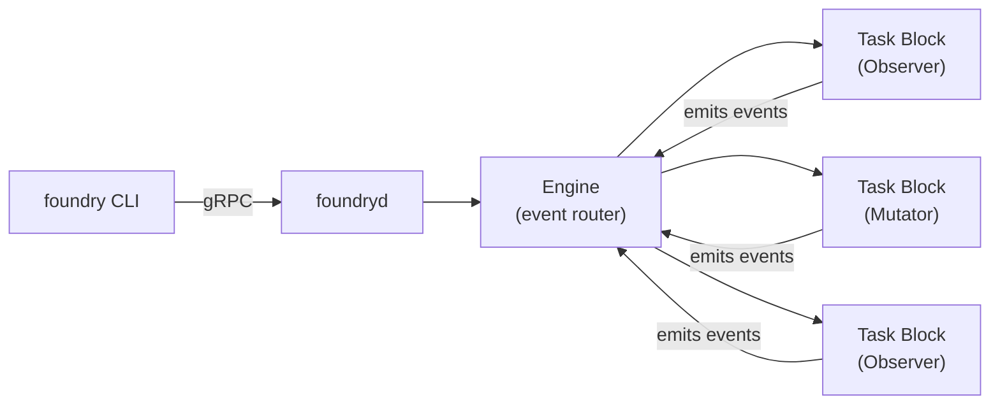

# Foundry Workflow Engine

Foundry is an event-driven workflow engine for engineering automation. It runs
as a daemon (`foundryd`) controlled by a CLI (`foundry`). Projects are
registered in a central registry, and Foundry orchestrates quality gates,
AI-assisted iteration, dependency maintenance, vulnerability remediation, and
drift detection across them.

## Which daemon you are talking to

**Production Foundry** is `foundryd` on `mojility-ops-01`: the nightly,
the sentinels, the ledger and every real project's work. Reach it over SSH
(`ssh mojility-ops-01 foundry queue`). On the Mac, plain `foundry`
targets the **development daemon**, whose registry holds only synthetic
sandbox projects under `~/.foundry/sandbox/` (`sample-rs`); never register a
real project with it.

Work on Foundry itself is designed and iterated on the Mac against that
daemon and promoted to ops-01 by the manual release in the repository's
`AGENTS.md`, at a quiet point. **Never dispatch a `foundry task` or a
campaign against the `foundry` project on production**: the restart that
follows kills other projects' running sessions, and a defective change
breaks the executor for everyone.

## Architecture at a Glance



The CLI emits events into the daemon. The engine routes each event to task
blocks that declared interest. Blocks execute and may emit new events, forming
chains. Every event and block execution is recorded in traces.

## Common Workflows

### 1. Iterate on a Project

Run an AI-assisted quality improvement cycle: charter check, assessment, triage,
planning, execution, gate verification.

```bash
foundry iterate <project-name>
```

What happens:

- Validates the project has intent documentation (CHARTER.md or equivalent)
- Resolves quality gates from `.hone-gates.json`
- Runs preflight gates to establish baseline
- AI assesses the project against its charter
- AI triages whether the assessment warrants action
- AI creates a correction plan and executes it
- Gates are re-verified; retries up to 3 times if they fail
- Results are summarized

### 2. Scout for Intent Drift

Detect potential bugs and architectural mismatches without making changes.

```bash
foundry scout <project-name>
```

Returns ranked candidates with divergence type, severity, confidence, and
suggested next steps. High-value candidates are marked with `***`.

### 3. Validate Gate Health

Check whether a project's quality gates pass without running iterate or
maintain.

```bash
# Single project
foundry validate <project-name>

# Multiple projects
foundry validate alpha beta gamma

# All active projects
foundry validate --all
```

Exits with code 1 if any project fails. Useful in CI or as a quick health check.

### 4. Run Full Maintenance

Run maintenance across all registered projects (or a single one).

```bash
# All active projects
foundry run

# Single project
foundry run --project <name>

# Dry run (no mutations, simulated success)
foundry run --throttle dry_run
```

Each project goes through validation, then routes to iterate or maintain based
on its registry flags.

Maintain works from a dependency brief decided in code under the project's
`update_policy` (`patch` | `minor` | `major`; unset behaves as `minor`). The
agent applies exactly the listed updates. Majors become separate
`foundry task` runs after the nightly (for `major` projects) or proposals with
a command (for the others). See what a project would get with:

```bash
foundry deps <project>                  # outdated deps, the brief, the majors plan
foundry deps <project> --policy major   # preview another policy; registry unchanged
```

When an otherwise eligible nightly major upgrade matches a `preserved` ledger
item by exact registered project, package and target version, the majors lane
resumes that obligation from its preservation ref and original objective. Its
child records `kind: major_upgrade`, `lane: maintenance`, origin `nightly majors
lane` and the exact `resumes` id; automation records no operator action. The
parent retains its submission identity and evidence. Only an actual child
landing settles the preserved parent landed; other outcomes leave it open,
and owner cancellation remains terminal. A selected resume admission failure
is reported and never falls back to a fresh task.

Continuations count against the existing nightly caps and run sequentially
with fresh upgrades in the existing order. Update policies, holds, security
eligibility, successful maintenance and in-flight suppression still apply.
Reviews, dry runs and interrupted-cycle summaries dispatch nothing. Without a
matching preserved ledger item, the existing fresh-task and history-suppression
rules apply. Owner `queue resume` remains an interactive, asynchronous task.

The same chain fires automatically every night at 02:00 local time via the
in-daemon `nightly-maintenance` sentinel. Inspect or toggle it with
`foundry sentinel list | show | enable | disable` (see "Sentinels" below).

### 5. Run One Task

Run one concrete user-provided coding task against a registered project:

```bash
foundry task <project-name> "Add a --quiet flag to the CLI and cover it with tests"
foundry task <project-name> "Fix the failing parser regression" --agent codex
foundry task <project-name> "Add retries to the uploader" --origin "asked by Stacey in standup"
foundry task <project-name> "Bump the API client" --after wi_0123456789abcdef01234567 --not-before 2h
```

`--origin <text>` is a free-text note recorded on the work item beside the CLI
client's hostname. It is opaque — it changes nothing about how the task runs.

`--after <id>` (repeatable) makes the task wait until that work item has
settled `landed`; an id not in the ledger is refused. `--not-before` takes an
RFC 3339 timestamp or a duration from now (`90s`, `30m`, `2h`, `1d`).

`--continues <id>` (repeatable) records that the task follows up on an open
item of the same project (`preserved`, `needs_decision` or `failed`), such as
fixing review findings on its branch. It is lineage only: no change to the
task's base or objective, and no waiting. An unknown id is refused with
`INVALID_ARGUMENT`, another project's item or a settled one with
`FAILED_PRECONDITION`. When the task lands, each continued item still open
settles `landed` with reason `superseded by <commit> via <new item id>`; if it
does not land, they stay open. `queue show` lists the ids under `Continues:`.

The task is recorded `queued` and the pacing scheduler starts it when the rules
allow (one mutating item per repository, the host running cap, `--not-before`,
`--after`, lane not paused); the command waits through that queue time, and
`foundry pacing show` says why it waits. See "Pace the work" below.

The task runs inside an isolated Git worktree, checks the project charter,
resolves and verifies gates, and performs a skeptical read-only review. It ends
with one structural verdict: `complete`, `remainder`, `defect`,
`blocked_on_decision`, or `runner_error`.

Complete work with passing required gates lands on trunk. A converging
`remainder` also lands when at least one required gate ran and every required
gate passed; its reviewer gaps become the campaign's next objective. Every other
non-complete result is committed and preserved on a named remote branch, with a
Git bundle fallback when push is unavailable. The task formation never retries.

While the command is waiting, it streams both workflow events and non-routable
block progress messages such as `running block Run Verify Gates` and
`finished block Run Verify Gates (ok, 143.0s)`. Progress observations are
persisted to the event log for auditability, but never delivered to downstream
task blocks. Every event published on Foundry's Watch stream is durable.

Use this for small, concrete, immediately executable coding work.

The reviewer holds a task to every requirement literally, so write guarantees
the code can actually make. An absolute requirement the environment cannot meet
(exact behaviour past a security limit, a safe state when every control command
fails, a byte-level bound below a dependency's API) fails review round after
round, or drives the agent to fork the dependency. Name the threat, the
guarantee that answers it, and the residual you accept. When follow-ups keep
failing on the same requirement, re-read the requirement before dispatching
again. Link a follow-up to the item it fixes with `--continues <id>`, so the
earlier attempt settles when the follow-up lands.

### 6. Manage Durable Campaigns

Use a campaign when the mission is broader than one task and the next objective
should be derived from implementation experience and current evidence.

Full reassessment of the remaining mission after every implementation cycle is a
core campaign design feature. Implementation can reveal hidden dependencies,
invalid assumptions, partial solutions, or work already complete. Use those
findings, reviewer results, preserved work, and the live repository to reconsider
scope, priority, and task decomposition within the mission and owner constraints.
Do not treat formation as selecting from a fixed plan or replaying reviewer gaps.
The final assessment checks the whole mission, beyond the last task's objective.

Judge assessment by the decisions and learning it produces. Token volume or
formation-session count alone does not establish waste. Cost reductions must
preserve full reassessment and useful evidence. The charter defines this principle;
`book/src/guide/campaigns.md` explains the loop.

```bash
foundry campaign add ./campaign.json
foundry campaign list
foundry campaign show <name> [--json]
foundry campaign report <name> [--json]
foundry campaign advance <name> [--origin "<note>"]
foundry campaign pause <name>
foundry campaign decide <name> --decision "Use the generated tonic client path." [--add-cycles N]  # --add-cycles: escalated only
foundry campaign complete <name> --reason "Production evidence confirms the mission shipped."
foundry campaign cancel <name> --reason "Superseded." [--now] [--discard-work]
foundry campaign resume <name> [--add-cycles N]
```

`foundry campaign show <name>` prints the campaign; for an escalated campaign,
an `Escalation:` block with the reason (and the task agent's question and
choices when a task asked one); `Owner options:` with the command lines the
owner can run now; and then its cycles as the
work-item ledger records them (`Cycles in the ledger:`), read through the
`ListWorkItems` campaign filter `campaign:<name>`. This is the same list
`foundry queue --source campaign:<name>` prints. Never infer it from traces.
Cycles that predate the typed source print `(none recorded)`. An earlier open
cycle settles `cancelled` (`carried forward by campaign <name> cycle <n> (<id>)`)
when a later cycle starts, and the remaining open cycles settle
`cancelled` when the campaign completes or is cancelled. An escalated cycle
stays open until the campaign advances again or ends.

`foundry campaign advance <name>` returns promptly whatever other campaigns
are forming. It never duplicates work: when the campaign already has an advance
or a cycle submitted, queued, held or running, it dispatches nothing, prints
`Campaign '<name>' already has a cycle in flight: work item <id> (<state>).
Nothing dispatched.` with `next: foundry queue show <id>`, and exits 0. Do not
retry a slow advance; check `foundry queue` instead.

Campaign definitions live in the daemon-owned campaign store. By default,
`foundry campaign add/list/show/advance/pause/resume/decide/complete/cancel` all go
through typed gRPC and do not read or mutate the client-side
`FOUNDRY_CAMPAIGNS_PATH`. Successful online reads and mutations render the
daemon's typed response or workflow output directly, so stale client-side
campaign files cannot mask the live daemon-owned state. Pass `--offline` only
when the daemon is stopped and you intentionally need direct-file recovery. If
`foundryd` is unreachable, the online command fails and leaves any absent or
pre-existing client-side `FOUNDRY_CAMPAIGNS_PATH` untouched. Campaigns carry a
mission, neutral context artifact paths, required done evidence, escalation
rules, an owner authorization, an optional agent provider, and a campaign-level
cycle budget. The formation chooses exactly one of done, one next objective, or
escalation. A task result automatically requests the next advance; remainders
and defects continue from preserved work, while human decisions and runner
errors escalate. Completion and escalation are forced into the ops digest.

When owner-reviewed evidence proves a mission shipped outside the formation
loop, use `campaign complete` with a non-empty reason. Foundry records the
authorizing owner and reason, clears stale pending results, and emits the normal
campaign completion event. Pass `--offline` only when the daemon is stopped.

A landed final task still receives completion evaluation. An exhausted budget
with an unlanded non-complete result escalates before formation. Campaigns use
Codex by default and enforce one writable repository. Declare
`writable_repositories` as the project name alone; other declarations are
rejected. Claude and Codex both enforce this scope. Standalone tasks retain
their existing provider behaviour.

Campaign `budget.stages.formation_prompt_bytes` defaults to 32768 bytes.
Campaign agents have no clock deadline. Legacy stage time fields are ignored.
`campaign report --json` includes per-formation session and decision records,
transcript links, command/output observations, and separate partial native usage.
Partial observations never add to final token totals; missing data is explicit. Use `campaign report` to inspect stage tokens/time, unmeasured
or unpriced spend, landed cycles, and external repairs.

Coding sessions should run verbose checks through `foundry capture -- <command>`.
It needs no daemon, keeps full stdout/stderr logs, returns the actual exit code,
and prints a bounded failure tail. New campaign tasks must record early
acceptance proof, through the project's public API, in `.foundry/proof.json`
before broad expansion. See the campaign guide for the behavioral/direct proof
schema. Formation, execution, review and steering share one test-design rule:
the boundary a test proves is the public API, not a real network. Unit and
library tests use in-process doubles at the I/O boundary (a stub transport, a
fake gateway, an injected clock and sleeper), never real sockets, local
servers, external services, wall-clock assertions or real sleeps. A double at
the gateway or transport boundary is valid proof; mocking library internals is
not. Only a suite the project's own AGENTS.md or gate file designates as
integration or end-to-end keeps real infrastructure. A task that cannot
reach the acceptance boundary (a missing capability, access or owner decision)
records `.foundry/blocker.json` instead; review turns a valid one into a
`blocked_on_decision` owner question, not a missing-proof defect. In any task
worktree, `.foundry/` is Foundry scratch: nothing under it lands, except a
deletion of a file HEAD tracks there. Finalize copies every `.foundry` file
that did not land (new, gitignored, or an edited tracked file) to
`~/.foundry/evidence/<trace>/<attempt>/worktree/` before cleanup and records
the directory in the result's `uncommitted_artifacts` field. So a brief that
wants something in the repository names a normal project path such as `docs/`
or the test tree, and never asks repository files to cite `.foundry/` paths.

Each advance mints trace and cycle-span identity. Task-side events carry
`campaign_cycle`, and `CampaignAdvanceCompleted` retains the exact formation
prompt, selected provider, and done-evidence gate results, so a cycle can be
reconstructed from the event stream without inferring boundaries from time.

When a task finishes while its campaign is paused, Foundry durably retains the
typed result and preservation ref. The first manual advance after resume
consumes that pending result, preserving reviewer gaps and branch continuity.

Campaign gate evidence may declare repository-relative `artifacts`. Foundry
requires each path to exist before running the command, preventing tools that
silently ignore absent test files from yielding false-green evidence.

When a campaign escalates because its cycle budget is exhausted, resuming
requires an explicit owner-authorized extension, for example
`foundry campaign resume <name> --add-cycles 1`. To record a decision at the
same time, use `foundry campaign decide <name> --decision "<text>"
--add-cycles 1`. On a spent escalated budget, `decide` without `--add-cycles`
is refused and records nothing. A retried `decide` that repeats the latest
decision is refused, so cycles are never added twice.

Formation runs read-only and does not build or test. It takes test and gate
evidence from the done-gate results the daemon ran against trunk, and from the
last run result: a run with `landed: true` reached trunk only after every
required gate in the project's gate file passed in its worktree.

Record an owner's policy with `foundry campaign decide <name> --decision
"<text>"` as soon as the owner rules, on an `active`, `paused` or `escalated`
campaign. It appends an owner decision record, and every later formation prompt
treats every recorded owner decision as binding. On an active or paused campaign
nothing else changes: the status, budget and pending run result stay as they
are, and `--add-cycles` is refused (use `resume --add-cycles N` for a paused
campaign). A decision recorded while the campaign forms makes it form again
from the decision. On an escalated campaign, `decide` also returns it to
`active` instead of re-escalating on the same question. Completed, cancelled
and staged campaigns refuse it. By default,
campaign control commands require a reachable `foundryd` daemon; pass
`--offline` only when you intentionally want direct-file recovery while the
daemon is stopped.

Online control-plane mutations are persistence-atomic at the daemon boundary: if
a save fails during `pause`, `resume`, `decide`, or `complete`, the RPC returns
`INTERNAL`, the persisted campaign store stays byte-identical, and `complete`
does not emit `CampaignCompleted`.

Read `references/workflows.md` for the event chain and the campaign definition
example in `book/src/guide/campaigns.md` when preparing a new campaign.

### 7. Manage Sentinels

Sentinels are declarative, named, scheduled triggers that live inside `foundryd`
and emit an event when their schedule fires. They replace the per-machine
launchd plist that used to drive the nightly maintenance run.

```bash
# List configured sentinels
foundry sentinel list

# Show full details for one
foundry sentinel show nightly-maintenance

# Pause the schedule (e.g. before a debug session)
foundry sentinel disable nightly-maintenance

# Re-enable it
foundry sentinel enable nightly-maintenance
```

Without `--offline`, all four commands go through typed gRPC so reads and
writes observe daemon-owned state directly: `list` → `SentinelList`, `show` →
`SentinelShow`, `enable` → `SentinelEnable`, `disable` → `SentinelDisable`.
Pass `--offline` only to read or mutate `~/.foundry/sentinels.json` directly
when the daemon is not running. If `foundryd` is unreachable, the online
command fails and leaves any client-side `FOUNDRY_SENTINELS_PATH` absent or
untouched. Successful online `enable`/`disable` wake the scheduler
immediately; failed saves leave the daemon-owned sentinel store unchanged in
memory, on disk, and in subsequent `list`/`show` reads, and do not wake the
scheduler. The daemon persists via same-directory temp-file rename, so a failed
save does not fall back to direct destination writes or truncation. The file is auto-seeded with the canonical entries on
first daemon start, and the daemon additively merges any missing canonical
entries on every restart (so new Foundry releases that ship more sentinels
reach existing installs automatically).

**Canonical sentinels that ship today:**

- `nightly-maintenance` (`0 2 * * *`) — emits `maintenance_cycle_started`.
  Drives the full maintenance run across registered projects.
- `daily-commit-digest` (`0 17 * * *`) — emits `commit_digest_started`. Renders
  a markdown digest of every active project's commits in the last 24 hours and
  writes it to `{FOUNDRY_DIGESTS_DIR}/{YYYY-MM-DD}.md` (default
  `~/.foundry/digests/`). See `book/src/guide/commit-digest.md` for the full
  chain.
- `ops-digest` (`0 */3 * * *`) — emits `ops_digest_started`. Reads MBOS JSONL
  events from `{FOUNDRY_OPS_EVENTS_DIR}` (default
  `~/Work/Operations/Events/intake`), applies a pressure gate (≥25 new events or
  any anomaly), summarises via agent, and writes
  `{FOUNDRY_OPS_DIGESTS_DIR}/{YYYY-MM-DD}.md` (default
  `~/.foundry/ops-digests/`). Anomalies include P0 events, CI failures,
  unresolved maintenance interventions, high/critical vulnerability alerts, and
  maintenance runs with failed repos. See `book/src/guide/ops-digest.md` for the
  full chain.
- `nightly-supply-chain` (`0 6 * * *`) — emits `supply_chain_scan_started`.
  Scans active projects, classifies findings against `.supply-chain-allow.json`,
  and writes `{FOUNDRY_SUPPLY_CHAIN_DIR}/{YYYY-MM-DD}.md`. Remediation is dark
  by default and requires `FOUNDRY_SUPPLY_CHAIN_REMEDIATE`.

### 8. Derive Quality Gates

Auto-discover quality gates for a project using AI inspection.

```bash
# From a registered project
foundry gates <project-name>

# From any directory
foundry gates --dir /path/to/project

# Generate .hone-gates.json
foundry gates --init <project-name>
```

### 9. Check Pipeline Health

Check GitHub Actions pipeline status for a project and auto-remediate failures.

```bash
foundry pipeline <project-name>
```

What happens:

- Looks up the project's repo and branch from the registry
- Runs `gh run list` to check GitHub Actions pipeline status
- If pipeline is passing, reports success and stops
- If pipeline is failing, fetches failure logs with `gh run view --log-failed`
- Invokes Claude with Coding capability and Full access to diagnose and fix CI
  failures
- Commits and pushes the fix

### 10. Release a Project

Run an agent-driven release workflow: quality gates, changelog, version bump,
tag, push, pipeline watch, local install.

```bash
# Auto-determine bump from changelog
foundry release <project-name>

# Specify bump type
foundry release <project-name> --bump patch
foundry release <project-name> --bump minor
foundry release <project-name> --bump major
```

What happens:

- Requires `release` action enabled in the project's registry entry
- Invokes Claude agent to follow the release process in the project's AGENTS.md
- If no `--bump` is specified, the agent determines the appropriate bump from
  changelog and unreleased changes
- Agent runs quality gates, updates changelog, bumps version, commits, tags, and
  pushes
- After release completes, watches the CI/CD pipeline for the release tag
- Once pipeline succeeds, installs the new version locally

The release chain also fires automatically during vulnerability remediation when
the main branch is clean after a CVE fix.

### 11. Inspect the Work Queue

The work-item ledger is the durable record of every unit of work Foundry
dispatched. `foundry queue`, `show` and `open` read it.

```bash
# Everything on one screen: running, queued, open, newest 20 settled
foundry queue

# Only what still needs a person: open items, then escalated campaigns
foundry queue open

# One item's full durable record, then its work_item_* events
foundry queue show wi_0123456789abcdef01234567

# Machine-readable
foundry queue --json
foundry queue show wi_0123456789abcdef01234567 --json

# Only what one dispatcher started, as <kind>:<ref>
foundry queue --source campaign:bedrock-gated-trials-v1   # every cycle of that campaign
foundry queue --source sentinel:nightly-maintenance       # what the nightly started
foundry queue open --source operator:workbench            # open work asked for from that host
```

The four groups are **running**, **queued** (`submitted`, `queued` or `held`), **open**
(`preserved`, `needs_decision`, `failed` — settled but still owing something to
a person), and the newest 20 **settled** items (`landed`, `cancelled`). The
20-item cap applies to the settled group alone.

The open group ends with every **escalated campaign**, one row each
(`campaign <name> <project> escalated <when> <reason>` and a
`next: foundry campaign show <name> (<controls>)` line). An escalation is
campaign state, not a ledger item, so it is never written to the ledger; the row
comes from `ListCampaigns` and names any open cycle item of the campaign as
`(open cycle <id>)`. `--source campaign:<name>` keeps that campaign's row;
Initiative filters show their initiative escalation instead. Other source
kinds show no campaign rows. The list forms' `--json` is an object,
`{"items": [...], "escalated_campaigns": [...]}`; through 0.44.4 it was a bare
array of items.

Every item records a typed `source` beside its free-text `origin`: what
dispatched it, as a closed kind with one ref — `campaign:<name>` with the
`cycle` number, `sentinel:<name>` (the nightly's per-project runs, its majors
lane, a remediation it reaches), `operator:<host>` (the CLI's `task`,
`iterate`, `run`, `release` and `pipeline`), or `work_item:<parent id>` (a
`queue resume` child, or a release cut after a remediation). Rows show it as a
column (`-` when none was recorded), `show` prints a `Source:` line only when
one was recorded, and `--json` carries a `source` object with `kind`, `ref` and
`cycle` or no key at all. Items recorded before the source existed have none;
read that as "not recorded", never as a kind. `--source` is an exact match on
kind and ref; an unknown kind, or a kind with no ref, is refused.

Start with `foundry queue open` when you want the shortest answer to "what is
waiting on me?" — those three states are settled but unfinished, and an
escalated campaign has stopped until its owner acts.

`show` prints every durable field, including `verdict`, `landed_commit`,
`preservation_ref`, `worktree`, `worktree_removed`, `trace_id`, and for paced
work `Depends on:` and `Not before:`. An optional
field the ledger never recorded prints no line at all, so a recorded
`worktree_removed: false` reads `no` while an unrecorded one is silent. After
the record, `show` lists the item's own `work_item_*` events (submitted,
started, settled, cancelled, held, released), oldest first, one line each — selected by the
item id in the event payload, never by trace or project, from every monthly
event log however old. An item with none prints `(no events)`; `--json` adds an
`events` array beside the unchanged record keys.

Without `--offline`, all three go through typed gRPC against daemon-owned state:
the list forms render `ListWorkItems`, `show` renders `GetWorkItem` then
`ListWorkItemEvents`. The online path never reads, creates or mutates the
client-side ledger or events files, and if `foundryd` is unreachable the
command fails with an error naming the matching `--offline` command rather than
falling back. Pass `--offline` only to read `~/.foundry/work-items.json` (and,
for `show`, `~/.foundry/events/`) directly when the daemon is not running; a
missing file renders empty groups and exits zero, a malformed one is an error.

On every start `foundryd` settles each item still `running` as `failed` with the
reason `daemon restarted`, so after a restart look in `foundry queue open` for
work that needs re-dispatching.

### Close, cancel, hold or release an item

```bash
foundry queue resume wi_0123456789abcdef01234567 --origin "finish preserved work" [--after <id>]... [--not-before <when>]
foundry queue close wi_0123456789abcdef01234567 --reason "Reviewed; no further work required" --origin "owner review"
foundry queue cancel wi_0123456789abcdef01234567 --origin "withdrawn request"
foundry queue hold wi_0123456789abcdef01234567 --origin "wait for the review"
foundry queue release wi_0123456789abcdef01234567
```

`close` discharges an open obligation in `preserved`, `needs_decision` or
`failed`; it requires a nonblank `--reason`. `cancel` stops a `submitted`,
`queued` or `held` item and records the reason `cancelled by operator`, without
requiring a reason argument. Both settle exactly the requested id as `cancelled`.

`hold` takes a `queued` item out of the scheduler's hands; it sits `held` with
the reason `held by operator` until released. `release` returns a held item, or
one in `needs_decision` because a dependency settled some way other than
`landed`, to `queued`; the settled dependencies are dropped and the item runs
regardless of them. Both emit `work_item_held` / `work_item_released` on Watch
and in the durable log, and follow the same daemon-only, `operator_action`
contract as `close` and `cancel`.

Both require the daemon, reject `--offline`, and never fall back to local
writes. They record this CLI's hostname and optional `--origin` in
`operator_action`, separately from the original submission origin. The action
retains the previous state, reason and settlement timestamp. Submission
identity, objective, trace and known disposition remain intact, including
preserved refs and worktree-removal observations. No agent starts, running
workflow stops, or preserved work is disposed of by either command.

The daemon reloads the ledger under its shared write gate and saves by atomic
replacement before emitting `work_item_cancelled` to Watch and the durable
log. Earlier event bytes stay untouched. Unknown ids return `NOT_FOUND`,
blank input returns `INVALID_ARGUMENT`, and other states return
`FAILED_PRECONDITION`. Malformed ledgers also return `FAILED_PRECONDITION`;
read or save failures return `INTERNAL` and a failed save emits no cancellation.
Concurrent requests for one item can succeed only once.

### 12. Pace the work

Every engineering workflow is recorded `queued` before it runs. Tasks, campaign
formation and cycles, manual and nightly maintenance, iteration, validation,
releases, remediation, supply-chain scans and digest agents share this queue.
The scheduler starts a root when no executing item occupies its repository,
the host cap (`max_running`, default 2) allows it, its `--not-before` has passed,
every `--after` item has settled `landed`, and its lane is not paused. Interactive
work is considered first, then oldest submission first. A queued item's reason
is the scheduler's current verdict (`repository busy: wi_…`,
`host at capacity N/N`, `not before <time>`, `waits on wi_…`, `lane paused`,
`ready`), shown on queue rows, `queue show`, `pacing show` and in `--json`.
A dependency that settles any way other than landed moves the dependent to
`needs_decision` with `waits on <id>, which settled <state>`; `queue release`
returns it to the queue.

The nightly stages every project before waiting. Queued and held maintenance
keeps its gather open across a restart. Cancelling a child reports failure.
Downstream release, remediation and cleanup steps retain their parent's slot.
Independent derived tasks queue before the parent releases its slot.
System summaries and digest agents use host capacity without project locks.
Supply-chain auto-fix reserves all active repositories for its sequential scan;
audit-only scans use a system slot. Dry runs also queue; observers run within
the cap, mutators remain simulated, and settlement states that explicitly.

```bash
foundry pacing show [--json] [--offline]                   # limits, running, waiting with reasons, paused lanes
foundry pacing pause --lane campaign --origin "quiet hours" # stop new starts in one lane; running items untouched
foundry pacing resume                                       # every lane (the default) may start again
foundry pacing drain --timeout 30m                          # pause all, wait until idle; exit 1 naming what still runs
```

`pause`/`resume` emit `pacing_paused`/`pacing_resumed` for the project
`system`; the pause state is persisted to `~/.foundry/pacing-state.json` and
is in force after a restart. The host cap lives in `~/.foundry/pacing.json`
(`{"max_running": 2}`); a missing file means the default. Queued and held
items survive a restart as they are; running items still settle `failed` with
`daemon restarted`. `drain` neither stops the daemon nor resumes the lanes
afterwards.

### Prefer convenience commands over raw emit

Always use the convenience commands above (`task`, `campaign`, `iterate`,
`scout`, `validate`, `run`, `gates`, `pipeline`, `release`) rather than
`foundry emit`. The convenience commands handle watch-stream setup, block
progress display, and trace rendering automatically.

Only use `foundry emit` for workflows that lack a convenience command (e.g.,
vulnerability scanning) or for advanced debugging:

```bash
foundry emit <event_type> --project <name> [--throttle full|dry_run] [--payload '{"key":"value"}'] [--wait]
```

## Registry Management

The registry (`~/.foundry/registry.json`) tracks which projects Foundry manages.
`init` is an explicit offline recovery command and rejects runs without
`--offline` before contacting the daemon or touching the filesystem. It never
uses the daemon, even when `foundryd` is running. `list`, `show`, `add`,
`remove`, and `edit` are daemon-authoritative in normal online use: they go
through `foundryd`'s typed gRPC API and operate on the daemon-owned registry
state. Add `--offline` only for explicit recovery when the daemon is not running
and you need to read or mutate the file directly. Without `--offline`, an
unreachable daemon is an error and the client-side registry file remains
untouched byte-for-byte. `list` and `show` render the daemon response directly
and never read the client-side registry file. If `FOUNDRY_REGISTRY_PATH` does
not exist, the online path leaves it absent rather than creating it. If daemon
persistence fails during an online add/edit/remove, the daemon returns a stable
`INTERNAL` error and leaves its registry state unchanged in memory and on disk.
Missing or duplicate projects surface typed `NotFound` and `AlreadyExists`
daemon statuses.

Valid `--stack` values: `rust`, `python`, `typescript`, `elixir`, `cpp`,
`swift`, `kotlin`. The stack picks the audit tool: Swift runs `osv-scanner` on
`Package.resolved`; Kotlin runs the project's own
`./gradlew dependencyCheckAggregate` and reads its JSON report.

```bash
# Initialize an empty registry during offline recovery
foundry --offline registry init

# Add a project through the daemon
foundry registry add \
  --name my-project \
  --path /path/to/project \
  --stack rust \
  --agent claude \
  --repo owner/repo \
  --branch main \
  --iterate --maintain --push

# Add without daemon (direct file write)
foundry --offline registry add \
  --name my-project \
  --path /path/to/project \
  --stack rust \
  --agent claude \
  --repo owner/repo

# List projects from the daemon-owned registry
foundry registry list
foundry registry list --json

# Show project details from the daemon-owned registry
foundry registry show my-project

# Edit project flags (use true/false)
foundry registry edit my-project --iterate true --maintain true

# Set how far maintenance may move dependencies (patch | minor | major)
foundry registry edit my-project --update-policy major

# Remove the install configuration
foundry registry edit my-project --clear-install

# Choose the skill install (true | false | "<command>")
foundry registry edit my-project --installs-skill "my-binary init --global --force"

# Remove a project
foundry registry remove my-project
```

**Key flags on each project:**

- `--iterate` / `--maintain` — enable iterate and/or maintain workflows
- `--push` — allow git push after changes
- `--audit` — enable vulnerability auditing
- `--release` — enable automatic releases
- `--update-policy` — dependency ceiling for maintenance: `patch` (lockfile only), `minor` (may widen constraints), `major` (majors become separate tasks). Unset behaves as `minor` and is flagged in the maintenance summary
- `--installs-skill` — skill install after the local install: `true` derives `<binary> init --global --force` (brew formula, else project name; skipped with no install config), `false` disables, any other value runs verbatim
- `--skip` — temporarily disable without removing

## Examining Results

Use CLI commands first — they format output and render traces as trees. Fall
back to raw files only when CLI output is insufficient.

- `foundry history` — recent runs (last 7 days); filter with `--project <name>`
  or a date (`foundry history 2026-03-29`)
- `foundry trace <event_id> --verbose` — drill into a specific run
- `foundry watch --project <name>` — live stream for runs in progress

Raw files on disk (when CLI isn't enough):

- `~/.foundry/audits/runs/YYYY-MM-DD/summary.md` — markdown summary after
  `foundry run`
- `~/.foundry/events/YYYY-MM.jsonl` — raw JSONL event log
- `~/.foundry/traces/YYYY-MM-DD/{event_id}.json` — full ProcessResult JSON

## Throttle Levels

Every event chain runs under a throttle that controls what blocks can do:

| Level     | Observers        | Mutators                          | Use Case        |
| --------- | ---------------- | --------------------------------- | --------------- |
| `full`    | Execute normally | Execute normally                  | Production runs |
| `dry_run` | Execute normally | Simulate success, no side effects | Safe preview    |

```bash
foundry run --throttle dry_run
foundry run --project alpha --throttle dry_run
```

## Workflow Status

Check what's currently running:

```bash
# All active workflows
foundry status

# Specific workflow
foundry status <workflow_id>
```

## Event Model Reference

For the complete event taxonomy, workflow chain diagrams, and naming
conventions, read `references/event-model.md`.

For detailed workflow descriptions including which blocks execute at each step,
read `references/workflows.md`.

Owner-directed preserved-work continuation uses `foundry queue resume <id>
[--origin <text>] [--after <id>]... [--not-before <when>]`. It requires a live
daemon and refuses `--offline`. Only a `preserved` item with a usable
preservation ref and a registered project can be resumed. Foundry records a
new task with the original objective, `queued` for the pacing scheduler, that
starts from the preserved local branch, remote ref or `bundle:<path>` through
the existing continuation path. When the preserved work does not contain current trunk, Foundry rebases it onto freshly fetched trunk before the agent starts (the preservation ref itself is not rewritten). If that rebase conflicts, the child is refused before any agent session: it settles `failed` with `land_blocked: continuation_conflict` and a reason that names the conflicting files, and the original stays `preserved`. The new record and its lifecycle payloads expose
`resumes`, the exact original id. Queue reads show this link in human and JSON
output. Submission identity and the parent's prior evidence remain intact;
the child records the hostname and optional origin in its `resume` operator
action.

The original obligation stays preserved until the linked task actually lands.
Then Foundry records its landing commit and appends `work_item_settled` for the
original. Failed, blocked, preserved and no-landing results leave it open.
An original cancelled by its owner stays cancelled even if its child lands.
Unknown ids return `NOT_FOUND`, blank inputs, an unknown `--after` id or an
unparsable `--not-before` `INVALID_ARGUMENT`, ineligible states or unusable
evidence `FAILED_PRECONDITION`, and persistence failures `INTERNAL`. A
rejected admission dispatches no execution and invokes no agent.

If the initial ledger save fails, no child or lifecycle events are created.
Otherwise admission stages a child in `failed` with reason `resume admission incomplete;
execution not dispatched`, no `started_at`, a `settled_at`, no disposition, and
`resumes` set to the exact preserved parent's id. The child becomes `queued`
only after the `work_item_submitted` lifecycle root persists and the final
ledger save succeeds; the scheduler then starts it and emits
`work_item_started`. A subsequent failure leaves the staged failed child and
preserves the parent and unrelated records.

Successful lifecycle appends remain in durable history and are delivered on
Watch, even when admission later fails. Failed writes are never advertised on
Watch. Earlier bytes, including partial failed appends, are never truncated or
rewritten. Lifecycle events alone are not proof of execution: consult the ledger
and RPC result, and continue from the preserved parent's id.

After a task actually lands, Foundry also checks that registered project's
other open ledger items (`preserved`, `needs_decision` or `failed`) that
recorded a preservation ref against the registered trunk branch, using the
registered checkout path. Three proofs, tried in this order, can settle such
an item `landed`:

- Ancestry: the preserved commit is reachable from trunk.
- Patch equivalence: `git cherry` matches every one of a nonempty set of
  preserved commits to a patch on trunk.
- Content containment: `git merge-tree --write-tree` merges the preserved
  commit into trunk without a conflict, and the merged tree is trunk's own
  tree. Trunk then already holds every change the branch makes relative to
  their merge base. This is how work that a later cycle squashed, or rebased
  with the same conflict resolution, is recognised when its patches no longer
  match.

Its `landed_commit` is the verified trunk commit and its reason is exactly
`superseded by <commit>`, whichever proof succeeded; the structured log names
the proof. The appended `work_item_settled` event carries
that item's exact id, project and original trace. Objective, submission origin,
`resumes` and prior preservation evidence remain intact.

A `needs_decision` or `failed` run keeps a preservation ref even when it made
no commits. Its branch then still points at the trunk commit it started from,
which every later trunk contains. Such an item settles only when its preserved
tip was committed after the item started, compared at whole seconds; otherwise
it stays open with a diagnostic, because its obligation is the question or the
fault, not work that can land. An open item without a preservation ref, such as
one blocked on a dependency before it ran, is not checked. Content containment
changes no ref, index or worktree; it writes the merged tree as unreferenced
loose objects, which garbage collection removes. It needs Git 2.38 or later.

Once an item settles landed, Foundry deletes only its recorded task branch
locally and its recorded preservation branch locally and on origin, best-effort.
Each deletion requires fresh ancestry, patch-equivalence or content-containment
proof against the registered trunk and refuses branches checked out in any worktree. A changed
ref fails the guarded deletion. Unowned refs, bundles and refs also owned by
unlanded items in any registered project sharing the repository are retained.
Ownership compares exact refs across repository slugs and shared Git common
directories, including separate clones and linked worktrees. The disposition
and settlement event retain ref names, observed commits and per-ref deletion
results; deletion failure leaves
the item landed. Preservation evidence for unlanded work is never deleted.
Cleanup decides eligibility under the ledger write gate, releases it for all
Git operations, then reloads under the gate to record outcomes. Concurrent
ledger updates are retained; a changed state or ref ownership is never
overwritten by stale cleanup evidence.

This check runs only after actual task landing. Failed, blocked, preserved and
no-landing task results do not trigger it. It checks only open items with a
preservation ref in the same registered project; owner-cancelled items remain
cancelled. A repeated
terminal does not append another settlement. The ledger is reloaded under the
shared write gate before saving, so concurrent owner actions and unrelated
updates are retained. A failed save emits no settlement.

Missing refs or objects, failed Git commands, preserved changes that trunk
does not hold (unmatched patches whose merge into trunk conflicts or would
still change trunk's tree), and ambiguous evidence leave the item open with an
explicit supersession diagnostic in the settlement block's result and
structured log. When patch equivalence and content containment both fail, the
diagnostic gives each reason. Empty Git output is never proof. Local branch refs and
commit ids are checked directly. Branch names are also checked by exact name
on `origin` when configured, without fetching; conflicting local and remote
heads remain unresolved. A remote-only head must already have locally available
objects. A bundle must advertise exactly one head and that commit must already be
locally available. Patch comparison and content containment require complete,
shared history; patch comparison rejects merge commits that `git cherry` cannot
account for. Queue show and JSON
expose the persisted commit and reason through the daemon's read path.
Scheduled invocation and the reporting reconciler are not delivered by this
landing-triggered check.

### Work reconciliation

`foundry queue reconcile` requires the daemon and prints that invocation's
report; `--offline` is rejected. The canonical `work-reconciler` sentinel uses
`30 */3 * * *` and pairs `work_reconcile_started` with `work_reconcile_completed`.
Inventory reports exact IDs, paths, branch refs and registered-trunk status.
Conservative supersession may settle open work with a preservation ref without a task landing;
concurrent owner changes win, and preservation evidence is retained. Landed
items receive the guarded branch cleanup described above; no agent is invoked. Errors surface as INTERNAL, and anomaly findings
force ops observation below its normal volume threshold. Reports use
`FOUNDRY_RECONCILE_DIR` (default `~/.foundry/reconcile`).

## Initiatives

Use an initiative when existing campaigns serve one shared outcome. Add the
campaigns first, then add the initiative definition. Each member's project
must be registered and included in the initiative's projects. Online commands
use the daemon; explicit `--offline` recovery uses the campaign store API.

```bash
foundry initiative add initiative.json
foundry initiative list
foundry initiative show shared-contract --json

foundry initiative advance shared-contract --member adopt-contract
foundry initiative hold shared-contract --member adopt-contract --reason "Owner review"
foundry initiative relay shared-contract --finding fnd_contract_port --member adopt-contract
foundry initiative ask shared-contract --question "Which port?" --member adopt-contract
foundry initiative dispatch shared-contract consumer "Verify the contract example"
foundry initiative milestone shared-contract --member publish-contract \
  --milestone contract-landed --evidence producer@a1b2c3d
foundry initiative decide shared-contract --decision "Use port 5001"
foundry initiative decide shared-contract \
  --decision "Keep the adapter" --member adopt-contract
foundry initiative brief set shared-contract BRIEF.md
foundry initiative brief show shared-contract
foundry finding add finding.json
foundry finding list shared-contract --member adopt-contract --json
foundry queue --source initiative:shared-contract
foundry initiative complete shared-contract --reason "The outcome was reviewed"
foundry initiative cancel shared-contract --reason "The outcome was withdrawn"
```

The definition contains `name`, `outcome`, `intent_refs`, `projects`, `members`,
`done_evidence`, `budget`, `authorized_by`, `providers` and `status`. Members
reference campaign names and optional `after` prerequisites. The shared budget
has `max_cycles`, `max_active_members` (default two) and `max_open_questions`.
The initiative owns member budgets. `foundry initiative advance <name>`
enables steering; passive initiatives retain manual campaign advance.

Decisions fan out to members that can still act (staged, active, paused or
escalated), even while they are active. Completed and cancelled members are
skipped; naming one with `--member` refuses the whole decide
(`FAILED_PRECONDITION`) and records nothing. With no member left to act, the
decision records on the initiative only. A changed
formation snapshot is discarded and formed again. `queue open` shows an
escalated initiative once, with member escalation rows suppressed. Open work
items retain their own rows.

The Sources page in ops-visualizer lists initiatives above campaigns with outcomes,
member results, integration evidence and questions. Its decision form submits the
selected members through the daemon and retains drafts when live results arrive.
`max_open_questions` caps the shared list (default three). Matching questions
appear once with the applicable members and earliest unanswered age. Extra member
questions remain on their campaigns; `deferred_question_count` reports them.
The next waiting question appears when an answer frees a slot. At the cap,
steering advances unblocked eligible work or waits for the owner. Questions older
than one day and initiatives inactive for thirty days are ops digest anomalies.

Foundry owns the brief at `~/.foundry/initiatives/<name>/BRIEF.md`. Definitions
must omit `brief`. Import external content with `brief set` after adding the
initiative. Formation and execution receive its path and SHA-256 hash.
Findings have an ID, initiative, source, applicable members, kind, text,
references and consumption records.
Kinds are `contract_changed`, `regression`, `blocker`, `evidence`, `owner_note`.
An empty `to` applies to all members. Reviewer gaps from landed cycles and
`defect` diagnoses create findings automatically. Formation and continuation
receive bounded findings newest first. Only a landing consumes what the
member's formation saw.

Campaigns and initiatives accept `providers: { formation, execution, review }`.
An explicit member stage overrides its initiative stage. Omitted stages use
`agent_provider`. Claude and Codex enforce the execution worktree boundary.
Claude uses the tested no-bypass write policy; worktrees remain under
`~/.foundry/worktrees`. Campaign reports separate stage tokens by provider.

From the repository that supplies Tracker intent, derive staged candidates:

```bash
foundry initiative derive --from et:goal:<id> --projects producer,consumer
foundry initiative derive --from et:journey:<id> --projects producer,consumer
```

Optional `--authorized-by <owner>` defaults to the invoking user. Derivation
records the initiative and staged candidates in Foundry without dispatching
member campaigns. Add `--integration-gates <file>` to attach a JSON array of
gate definitions. The file accepts only `kind: gate` entries; Tracker still
supplies the outcome reviews.

A committed projection is preferred. Otherwise the et CLI reads intent from
that repository root. Foundry never reads its credentials. Derivation changes no
Tracker state. Candidates come from `create`, `update`, `delete` interactions in
priority order; journey steps provide `after` order. First advance audits
the registered codebases and can activate approved candidates. Each steer
refreshes intent. Realised intent produces close proposals; integration evidence
and owner-confirmed `et close` complete the loop in slice 2.

`foundry initiative advance <name>` submits one outcome assessment and enables
steering after subsequent member settlements. `--member <name>` pins the next
advance and releases that member's owner hold. Steering chooses one typed
`advance`, `dispatch`, `hold`, `relay`, `ask`, `stage`, `done`, `escalate` or
`wait` action. The retained
`initiative_steered` fact includes the prompt, provider and decision.
Foundry computes the eligible members first and skips the agent when no action
can apply (outcome `skipped`). `wait` needs a reason and opens no question; use
`ask` only for an owner question. A hold or relay already in force is a
`no_op`. A guard's refusal is `rejected` and settles the steer `cancelled`, not
`failed`, so only genuine faults appear in `queue open`.

Queued formation, reserved admissions, running cycles and standalone tasks
count toward `max_active_members`; a completed or cancelled member counts only
while one of its cycles still runs.

Initiative decisions answer only explicit question IDs. Use
`foundry initiative decide <name> --question <id> --decision "<answer>"`.
Repeat `--question` for several questions. Without `--member`, answers reach
only the selected questions' members; `--member` can select a subset.
Other questions remain open, including questions for those same members.
Without `--question`, `decide` records binding policy and answers no questions.
Use `foundry initiative note <name> --text "<status>"` for observations.
Notes are durable, nonbinding context. They do not answer questions, resume
campaigns, release holds, change budgets, or request steering.
`initiative show` exposes open and deferred question IDs.
RPC clients must use `RecordInitiativeDecision` with explicit `question_ids`
to answer questions. Updated CLI decisions refuse older daemons without mutation.

Operational blockers use typed recovery, not owner questions. Campaign and
initiative `show` expose `recovery` with its ID, cause and exact detail.
Use `campaign recover <name> --recovery <id> --evidence "<what changed>"` or
`initiative recover <name> --recovery <id> --evidence "<what changed>"`.
An agent can request a recheck after an authorized operational correction.
The daemon reassesses under existing gates, questions, holds and budgets;
recovery records no owner decision and adds no cycles. A campaign pause stays.
New RPCs refuse older daemons without a decision or resume fallback.
Standalone operational blockers preserve work; use `queue resume <id>` after
correcting their prerequisite. `.foundry/blocker.json` can set `recovery_kind`
to `capability_unavailable`, `access_unavailable`, `environment_unavailable`,
`missing_evidence`, `unmet_precondition` or `runner_unavailable`.
Without that field, legacy blockers still represent owner decisions.

`initiative show` exposes computed `readiness` with typed blockers and exact
dependency evidence. Online reads check the current ledger and registry;
offline reads say `live: false`. This is admission readiness, not release or
deployment proof. A bare `after: ["producer"]` now requires the producer's
completed outcome. Use `producer:landed` for an intentional first-landing
prerequisite, or `producer:<milestone>` for exact recorded evidence. Partial
landings and notes never satisfy completion. Conditional `hold --until`
ends when all declared prerequisites have proof; indefinite owner holds stay.
Dependency waits require no owner decision, spend no cycle and leave unrelated
members eligible. Admission rechecks controls before starting work.

Shared cycles include initiative tasks. Use
`initiative decide --add-cycles N` to authorize more shared cycles. Once the
shared budget is spent, `initiative decide` without `--add-cycles` is refused
and records nothing. Member budget grants cannot exceed that total. Owner holds and shared questions block
ineligible work; milestone holds require explicit evidence.

The first steer audits Tracker candidates against registered codebases. Audit
findings retain checked paths and classify intent as `realised`, `partial`,
`absent` or `misplaced`. Each steer refreshes intent from the supplying repo;
that repo need not be a registered writable target. Withdrawn intent stops its
owned work gracefully. Realised intent records a close proposal without an ET
write. Slice 2 checks integration evidence, stages campaigns for uncovered work
and proposes completion for owner confirmation.

Only one assessment runs per initiative. Changed store or trunk evidence
invalidates output. Durable pending actions recover on restart without double
spending or dispatch. A steering hold, relay, ask, escalate or stage that
changes state but dispatches nothing requests exactly one follow-up assessment
when the recomputed precheck still lists an eligible member. The follow-up
carries `follow_up_of` (the earlier steer id and step) on its request, steering
record and `initiative_steered` fact, and never requests another. Wait, no-op,
skipped, rejected, stale and failed passes request none, and a queued or
running assessment for the initiative absorbs the request. Existing initiatives remain passive until explicitly advanced.

Optional `provider_pairings` explicitly alternates stage maps. Member stage
overrides remain binding, and continuations retain their admitted pairing.
Without that setting, Foundry keeps the configured stage providers.

### Initiative outcome evidence

A library distributed through a package registry self-validates: its own tests
consume it through its public API and packaged artifact, against its contract
documents and fixtures, and a fresh consumer install verifies the release.
Dependents verify when they adopt the released version, in their own work, not
against an unreleased library.

For a changed boundary between running applications or services, require
provider and consumer verification of the same versioned executable contract
set in each project's required gates.
Cover relevant errors, optional fields and supported versions.
Retain the contract version or hash, tested commits and both verification results.
Matching schemas, or mocks each side writes independently of the other, do not
prove that two services agree; derive cross-service test doubles from the
verified contract set. A boundary double inside one repository is still valid
proof.
Coordinate missing verification through the initiative within authorized repositories.
Integration gates also check wiring and the user's full journey.
The initiative reminder is agent guidance.
It does not add an automatic contract verifier.

Initiative integration gates use `done_evidence` entries of kind `gate`, with
`command`, optional `host`, `required` and repository-relative `artifacts`.
The default host is the daemon's host. Named remote hosts use SSH and their
online registry API. Foundry fetches and fast-forwards registered trunks,
then creates disposable copies named after each registered project.
Commands and artifact paths start at the shared parent directory.
`foundry capture` retains stdout and stderr. Results retain host, trunk commits
and log references. Missing artifacts or failed updates cannot pass a gate.
Failures become initiative findings.

Steering can `stage` a validated campaign within the initiative's projects.
It becomes a member under the existing shared authorization and budget.
Staging does not start an execution cycle.
A `done` action supplies evidence for every outcome review.
Passing required integration gates and current intent are enforced in code.
The initiative stays open until the owner confirms with
`initiative complete <name> --reason <text>`.
Changed trunks, intent or owner policy require a fresh assessment.

For derived initiatives, confirmed completion invokes `et close` from the
supplying repository for verified interactions, then the goal when its
children and success criteria are satisfied. Closure receipts survive partial
failure and restart. Failed closure leaves the initiative open.
Offline recovery cannot bypass outcome evidence or write Tracker state.
Cancellation never closes Tracker. Development stays on the Mac; promotion
still requires Stacey's go-ahead.
